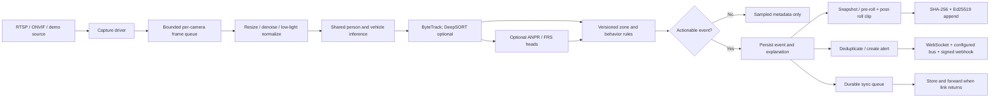

# FALCON Backend Schema and Processing Contract

**Status:** Database and process specification; see `docs/ASSUMPTIONS.md` for source conflicts.  
**Schema source:** `db/schema.sql`  
**ERD:** `docs/ERD.md`  
**API baseline:** `docs/PRD.md` Section 6.4 and `docs/TRD.md` Section 10.

**Pipeline summary:** `CCTV Feed → GStreamer/OpenCV Capture → Preprocessing → YOLO Detection → ByteTrack Tracking → Optional Face/ANPR Heads → Versioned Fence/Behavior Rules → Explainable Event → Alert + Evidence → FastAPI/WebSocket → PostgreSQL/TimescaleDB + Object Storage → Local Dashboard and Store-and-Forward Sync`.

## 1. Repository layout and delivery plan

The requested backend spans multiple services. This schema-first increment creates the architecture/assumption docs, ERD and SQL bootstrap. It does not claim the API, CV workers, deployment files or tests are implemented yet.

```text
Falcon_Eye/
  apps/
    api_gateway/                 # Planned FastAPI REST/WebSocket edge
    capture_node/                # Planned RTSP/ONVIF capture drivers
    inference_service/           # Planned shared detection pipeline
    rule_engine/                 # Planned fence and behavior rules
    alert_service/               # Planned lifecycle and fan-out
    ledger_service/              # Planned evidence hash chain and verification
    sync_service/                # Planned edge store-and-forward
    dashboard/                   # Frontend, specified separately
  db/
    schema.sql                   # Added: PostgreSQL/Timescale baseline schema
  docs/
    ASSUMPTIONS.md               # Added: conflicts and defaults
    BACKEND_SCHEMA.md            # Added: processing and API contract
    ERD.md                       # Added: entity relationships
  deploy/                        # Planned Compose, NUC/Jetson and systemd
  models/registry/               # Planned signed model artifacts
  packages/contracts/            # Planned shared schemas
  scripts/                       # Planned seed, import, benchmark and simulation
  tests/                         # Planned unit/integration/system/security suites
```

### Delivery sequence

1. Establish canonical data contracts and database schema (this increment).
2. Implement Alembic migrations and database integration tests against PostgreSQL 16/TimescaleDB.
3. Implement auth/RBAC, audit chain, and P0 API-001–015, API-019–022, API-025–030.
4. Implement camera and inference workers; preserve shared detection/track schemas.
5. Add zone/rule, evidence, alert and offline synchronization services.
6. Add governed P1 ANPR/FRS, night support, analytics and model lifecycle.
7. Add deployment, observability, load tests, security tests and demo fixtures.

## 2. End-to-end processing



Each camera has one capture/analytics pipeline. Capture never waits for inference: bounded frame queues drop the oldest unprocessed frame when full and increment a dropped-frame metric. Alert, evidence and sync work use durable queues and are not dropped silently. Heavy inference executes in worker processes, not the async API event loop.

### Stage contracts

| Stage | Input | Output / persistence | Failure behavior |
|---|---|---|---|
| Capture | Camera config/driver | Timestamped frame and source metadata | Reconnect with TRD 2–30 second backoff; emit camera health transitions |
| Preprocess | Frame and camera mode | Normalized frame; mode/degradation metadata | Fall back to safe preprocessing and mark degraded |
| Detect | Frame, active signed model | Person/vehicle detections with confidence, box, frame/time/model IDs | Do not load invalid signature; report model/camera fault |
| Track | Detections | Stable per-camera track ID and ground point | Expire using configured tracker lifecycle; no cross-camera identity claim |
| ANPR/FRS | Optional crop | Candidate read/match plus quality/confidence | Disabled without model/governance; reject low-quality face crop |
| Rule engine | Tracks, active zone/rule version | Explainable event candidate | No alert from raw motion; store rule inputs/version |
| Event/evidence | Candidate + frames | Event, snapshot/clip, manifest and integrity entry | Persist precise evidence failure reason; no successful badge |
| Alert | Event | Deduplicated alert and action history | Idempotent creation; state transitions validated |
| Fan-out | Alert change | WS + one selected MQTT/Redis mode + webhook retries | Retry with bounded backoff; dead-letter after configured attempts |
| Sync | Outbox entity | Ordered, idempotent central acknowledgement | Keep locally durable and show pending/conflict state |

## 3. Database contract

`db/schema.sql` uses canonical PRD/TRD table names and adds support tables from the backend prompt. Timescale hypertable primary/unique keys include each partition timestamp. API identifiers can remain UUIDs; DB foreign keys use the composite time-series key to avoid invalid references.

| Domain | Tables | Purpose |
|---|---|---|
| Site and edge | `organizations`, `sites`, `devices`, `cameras` | Multi-site scoping, edge node identity, camera metadata and secret references |
| Identity and access | `users`, `roles`, `user_roles`, `user_site_access`, `api_keys`, `auth_sessions` | RBAC, per-site access, hashed API/refresh credentials |
| Configuration | `zones`, `models`, `camera_model_assignments`, `configs`, `alert_rules` | Versioned camera rules, signed model registry, active config revisions |
| Analytics | `tracks`, `detections`, `events`, `anpr_reads`, `face_matches` | Time-series observations and explainable event records |
| Event identity | `event_index` | Stable relational key/retention state for events stored in the time-series hypertable |
| Alerts | `alerts`, `alert_actions`, `alert_deliveries` | State machine, assignments, audited actions and notification attempts |
| Watchlists | `watchlist_plates`, `watchlist_faces`, `face_embeddings` | Expiring approved entries; encrypted face embeddings |
| Evidence/integrity | `evidence_files`, `evidence_access_log`, `ledger_entries`, `ledger_blocks` | Object references, access history, signed hash chain and optional local anchors |
| Operations | `camera_health`, `health_metrics`, `sync_queue`, `webhook_endpoints`, `webhook_deliveries` | Telemetry, durable outbox and delivery retry state |
| Governance | `audit_logs`, `retention_policies`, `model_feedback` | Tamper-evident audit, retention/legal hold and feedback candidates |

Camera URI secrets are represented by `credential_ref` and encrypted URI fields; application code must never place a password in logs, API responses, exported configuration or query strings. Evidence object keys are not signed URLs; short-lived download URLs are generated only after authorization. `event_index` and `events` are inserted atomically. The time-series retention policy drops event payload chunks; a retention worker separately clears relational event dependencies only when their evidence, alert, ledger and legal-hold policies allow it.

## 3.1 Capability implementation map

| Required capability | Schema support | Service status in this increment |
|---|---|---|
| Human/vehicle detection and tracking | `detections`, `tracks`, `models` | Schema defined; inference/tracker worker not implemented |
| Face detection and candidate matching | `watchlist_faces`, `face_embeddings`, `face_matches` | Privacy-aware schema defined; FRS worker/API not implemented |
| ANPR | `anpr_reads`, `watchlist_plates` | Schema defined; OCR/fusion worker/API not implemented |
| Virtual fence | `zones`, `configs`, `events` | Versioned schema defined; geometry/rule engine not implemented |
| Suspicious behavior | `alert_rules`, `tracks`, `events` | Rule configuration schema defined; behavior plugins not implemented |
| Night/IR/thermal | `cameras.camera_type`, `cameras.mode`, `models`, `detections.mode` | Selection metadata defined; preprocessing/models not implemented |
| Real-time alerts | `alerts`, `alert_actions`, `alert_deliveries`, `webhook_deliveries` | Persistence defined; API/WS/bus workers not implemented |
| Event/evidence history | `events`, `event_index`, `evidence_files`, `ledger_entries` | Persistence model defined; evidence worker/API/verifier not implemented |

### Data lifetimes

Use the PRD's defaults: events 365 days; detections 30 days; alerts 365 days; snapshots/clips 180 days; audit logs 7 years; face embeddings 180 days or watchlist expiry; feedback samples 365 days. Legal hold overrides deletion. The DDL applies time-series policies only where they are safe; evidence objects and related relational rows require a retention worker that checks legal hold, export/access references and audit requirements.

## 4. API and event processing

All REST routes use `/api/v1`, Bearer authentication, request IDs, RFC 7807-compatible errors, 50 default/200 maximum pagination, `Idempotency-Key` for mutations and `X-Node-Id` on edge writes. Exact API IDs and methods are in PRD Section 6.4. No endpoint should exceed its assigned role/site scope.

| Web/API area | Contract |
|---|---|
| Auth | PRD API-001/002; 15-minute access token, 24-hour refresh policy, privileged MFA |
| Camera and zone | API-003–010; secrets by reference; zone versions immutable after activation |
| Events and alerts | API-011–015; filter/page, stable IDs, valid lifecycle and reasoned feedback |
| Plate/face | API-016–018; purpose-bound audited searches; face results candidate-only |
| Evidence/ledger | API-019–022; <=15 minute link, server-side verify, signed manifest |
| Health/users/audit/analytics | API-025–030; role/scoped responses and request correlation |
| WebSocket | TRD `/ws/v1/operator`; `alert.created`, `alert.updated`, `camera.status`, `node.health`, `sync.pending`; sequence gap triggers REST resync |
| Webhooks | PRD HMAC-SHA256 headers and retry schedule; endpoint secrets are referenced/encrypted, not returned |

## 5. Alert lifecycle and transaction boundary

The canonical PRD state values are `new → acknowledged → escalated → resolved → closed` or `new → false_positive → closed`. A future `investigating` state from the later prompt is not accepted without a versioned API/schema change.

1. Create an event once using event idempotency key and captured timestamp.
2. Persist event explanation, source camera/site, model/rule versions and evidence status.
3. Create or merge alert under the configured cooldown key.
4. Append alert action and audit record in the same DB transaction as state mutation.
5. Publish the committed alert through a transactional outbox.
6. Deliver each external channel independently; record attempts and final delivery status.
7. On false-positive, store reason and model/rule/frame provenance; never alter original evidence.

Two concurrent actions use optimistic state validation. A stale action returns HTTP 409 with current state. The API does not claim a browser-side queued mutation is durably accepted.

## 6. Offline sync

The site-local node remains authoritative for local event creation during HQ outage. `sync_queue` persists an entity type, canonical payload, node sequence and unique idempotency key. Retry order is per source node; retries use the same key. Receivers record seen keys and return the prior result for duplicates. Evidence blobs upload resumably before a manifest is marked complete. Conflict response is explicit and retained for review; no last-write-wins overwrite for audit, evidence or ledger data. Queue depth and oldest pending age are exposed through health status.

## 7. Security and privacy defaults

- Password hashes are Argon2id when local password auth is enabled; refresh/API credentials are stored as hashes.
- Role checks and site scoping are enforced server-side for every object lookup.
- Face enrollment/search is unavailable unless authority-approved legal basis, expiry, supervisor approval, quality threshold, audit and human review are active.
- Face embeddings are encrypted bytes plus key reference; never log or return the raw embedding.
- Plate and face candidate matching never causes autonomous enforcement.
- Audit and ledger appends are append-only for the API database role; hash/signature verification is independently testable.
- Webhook and model secrets are managed outside Git and are not returned after creation.
- File upload must validate size, format, checksum and signature; SSRF-safe camera and webhook validation is required.
- External permissioned chain is optional; local hash chain works without Internet or cloud.

## 8. Required validation before calling schema runnable

`db/schema.sql` targets PostgreSQL 16 plus a compatible TimescaleDB extension. This environment has Python 3.14.6 but no PostgreSQL client or Docker, so database execution has not been verified here. Before deployment:

1. Create a clean PostgreSQL 16 database with the approved TimescaleDB extension/image.
2. From PowerShell, set `DATABASE_URL` to that database and run:

   ```powershell
   psql "$env:DATABASE_URL" --set ON_ERROR_STOP=on --file db/schema.sql
   ```

3. Confirm the SQL completes without errors and inspect `\dt`, `\d+ events`, and `\d+ detections`.
4. Confirm hypertable creation, composite foreign keys, compression, retention and continuous aggregate policies against the pinned TimescaleDB image.
5. Convert the bootstrap DDL into ordered Alembic migrations with upgrade/downgrade tests.
6. Add integration tests for DB-001–004, data retention and legal hold.
7. Run DB role tests proving app roles cannot update/delete audit or ledger rows.

