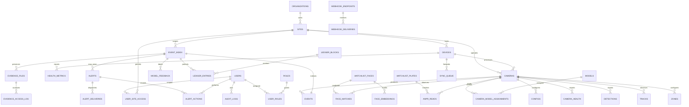

# FALCON Backend Entity Relationship Diagram

The ERD follows PRD/TRD canonical entity names. Hypertable entities are time-partitioned; relationships use composite `(id, timestamp)` references where required by TimescaleDB.

## Time-series partition keys

| Table | Partition column | Primary key |
|---|---|---|
| `events` | `captured_at` | `(id, captured_at)` |
| `detections` | `detected_at` | `(id, detected_at)` |
| `camera_health` | `sampled_at` | `(camera_id, sampled_at)` |
| `health_metrics` | `sampled_at` | `(device_id, metric_name, sampled_at)` |
| `anpr_reads` | `read_at` | `(id, read_at)` |
| `face_matches` | `matched_at` | `(id, matched_at)` |

`event_index` is the ordinary relational identity/retention row for a time-series event. Alerts/evidence/ledger reference it so the event hypertable can expire chunks without inbound foreign keys blocking chunk removal. The event writer inserts the index and hypertable row in one transaction. A retention worker removes dependent relational records only after checking their own retention and legal-hold policy. `alerts`, evidence metadata, ledger entries, watchlists and audit entities remain ordinary relational tables.
