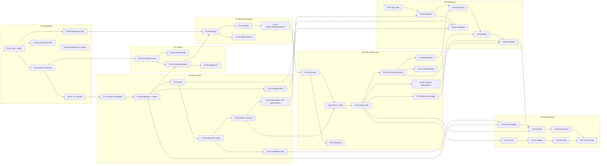

# Dependency Graph and Critical Path

This graph is a dependency view, not a calendar. Task IDs and owners are in [01_IMPLEMENTATION_PLAN.md](./01_IMPLEMENTATION_PLAN.md) and [04_TASK_BOARD.csv](./04_TASK_BOARD.csv). Workstreams may parallelize only after the stated dependency is complete.

## Critical path

`F0-01 → F2-01 → F2-03 → F3-01 → F3-02 → F3-03 → F4-01 → F4-02 → F4-04 → F4-05 → F4-06 → F9-03 → F13-03 → F15-03 → F15-05` (**118 person-hours** by current task estimates).

This longest dependency chain is calculated from `04_TASK_BOARD.csv`; it is not an elapsed-calendar forecast. Recalculate it whenever task dependencies or estimates change.

F0-06 (license/data review) can delay all real model inference; build only clearly labeled deterministic mock inference while that gate is unresolved. F1-01 requires actual PostgreSQL 16/TimescaleDB validation; static SQL inspection is not a substitute. F9-03 requires an actual media delivery path, not just an API mock.

## Parallel role lanes

| Lane | Can start after | Work | Integration contract |
|---|---|---|---|
| Backend | F0-01/F0-02 | Schema, migrations, auth/RBAC, CRUD, alert/evidence APIs, sync | Versioned OpenAPI; canonical PRD names/enums |
| CV-ML | F0-06 and detector input fixture | Preprocessing, detector/tracker adapters, geometry, rule plugins, benchmarks | Versioned frame/detection/track/event schemas; cached licensed weights |
| Frontend | F0-02 and WEB_FLOW/design review | App shell, auth, live, alerts, event/evidence, map/fence/admin | API mocks must match OpenAPI and are visibly test fixtures |
| DevOps | F0-01/F0-02 | CI, Compose, observability, packaging, offline cache, systemd | Health checks, version pins, explicit offline profile |
| QA | F0-03 and acceptance tests | Contract/fixtures, coverage, Playwright, robustness, metrics | Test IDs T0..T15 in task board; keep artifacts |
| Docs | Start immediately | Source decisions, training/privacy, operator runbooks, PPT traceability | No unsupported capability, market, legal or performance claims |

No lane may merge a mock as a real detector, silently broaden a role, or claim a hardware/protocol test that did not occur.
