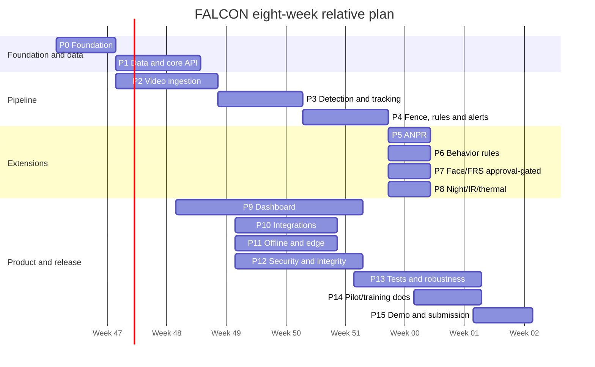

# Timeline, Milestones, Capacity and Cut Line

## Editable planning defaults

| Variable | Baseline | Note |
|---|---:|---|
| `TEAM_SIZE` | 6 | Requested default; actual roster/availability unconfirmed |
| `HOURS_PER_PERSON_PER_WEEK` | 20 | Requested planning assumption |
| `WEEKS_AVAILABLE` | 8 | Requested baseline; no official finale date found in the repository |
| Gross capacity | 960 h | 6 × 20 × 8 |
| Planned utilization ceiling | 80% = 768 h | Reserve 192 h for integration, review, incidents, leave and hardware waits |
| Task estimate total | 606 h | Sum of 79 rows in `04_TASK_BOARD.csv`; person-hours, not elapsed hours |
| Remaining below planned ceiling | 162 h | 768 − 606; not a promise that unplanned scope fits |

Dates are relative. Week 1 begins at team kickoff. Recalculate after roster, hardware and finale date are confirmed. If committed attendance is below six, recompute capacity; do not compress estimates to hide a shortfall.

## Week-by-week plan

| Week | Phase focus | Primary parallel work | Exit evidence |
|---|---|---|---|
| 1 | P0 Foundation | Repo/toolchain/CI; source/data/license review; architecture ADR; task board grooming | M1 prerequisites; clean reproducible CI; model/data gates recorded |
| 2 | P1 Data/API + P2 capture start | Validate DB/schema; migrations/auth; file driver and capture queue | M1 and first local file frames persisted/observable |
| 3 | P2 capture + P3 detection/tracking | RTSP/ONVIF mock/test; preprocess; class-aware detector and tracker | M2; measured baseline run with metadata |
| 4 | P4 virtual fence/rules/alerts | Geometry/importer; event/alert lifecycle; WS and local delivery | M3 API-side vertical slice |
| 5 | P9 dashboard vertical slice + P12 security | Login/site/live/alert pages; audit/evidence integrity; webhook mock | M3 visible end-to-end; M4 test plan underway |
| 6 | P9 completion + P10/P11 integration | Evidence/GIS/fence surfaces; sync/degraded mode; C2 mock; offline deploy | M4 local offline demo; M5 contracts ready |
| 7 | P5/P6/P8 opt-in extensions + P13 tests | ANPR/behavior/night only when gates pass; robustness and benchmark | Measured scope; M5 limitations and gaps published |
| 8 | P14/P15 release | Operator drill; restore/rollback; PPT matrix; rehearsal and backup | M6 submission evidence; all unverified claims marked |

Phases remain logically ordered as required; tasks may run in parallel when dependencies are satisfied. If hardware, dataset approval, or face-data approval is absent, use offline fixtures and keep the affected feature disabled rather than blocking the P0 slice.

## Mermaid Gantt

The Gantt uses an illustrative Monday 2026-11-23 kickoff based on the current planning date; it is **not** a confirmed SIH calendar. Rebase dates to the actual kickoff/finale once known. Task dependencies in [02_DEPENDENCY_GRAPH.md](./02_DEPENDENCY_GRAPH.md) are authoritative over the visual overlap.

## Milestones M1–M7

| Milestone | Target | Demoable outcome | Gate/evidence |
|---|---|---|---|
| M1 — Reproducible foundation | End W1 | Clean checkout installs and CI runs | Pinned toolchain, green checks, license/data policy |
| M2 — Capture and inference | End W3 | Local file frames → person/vehicle boxes/tracks | Reproducible run; explicit model/device/data metadata |
| M3 — First vertical slice | End W5 | Fence breach → persisted event/alert → dashboard push | Geometry/rule/API/UI tests and one local demo |
| M4 — Evidence and integrity | End W6 | Snapshot/clip → verify → audit record | Tamper/valid-chain tests, offline test, role/site checks |
| M5 — Optional analytics | End W7 | ANPR/behavior/night shown only if measurable | Per-feature quality/latency reports; otherwise disabled with reason |
| M6 — Operational readiness | End W8 | Operator walkthrough and rollback-capable local package | SOP, privacy/security gaps, tested recovery and known limits |
| M7 — Submission proof | End W8 | Five-minute demo, backup recording, PPT evidence index | Coverage self-audit; team ID filled; no unverified numbers presented as Falcon data |

## MoSCoW cut line

- **MUST:** toolchain/CI, validated schema and auth/RBAC, file-based camera path, class-aware detection/tracking, fence event, alert lifecycle/WS, evidence integrity, dashboard for live/alerts/evidence, offline demo, test/report gates, security/privacy gates, PPT traceability.
- **SHOULD:** RTSP/ONVIF on named hardware, MQTT/webhook/siren adapter, sync, GIS/fence editor, systemd/Compose, C2 mock, operator SOP.
- **COULD:** ANPR end-to-end, explainable behavior beyond fence/loiter, night/IR evaluation, FRS only with approvals, thermal sensor integration.
- **STRETCH:** production C4I/VMS certification, cross-camera re-ID, crawling/climbing action recognition, drone model, crowd analytics, sensor fusion, external permissioned-chain anchor, pan-India rollout.

The 606 h task baseline fits below the 768 h planned ceiling, but it does not fund unforeseen hardware procurement, custom dataset collection/labeling, training a production model from scratch, production legal certification, or deployment at a live border site. If those become mandatory, extend the schedule or cut SHOULD/COULD work; do not reduce QA/security gates.
