# FALCON Product Requirements Document

## PART 1 — Front Matter and Product Overview

### 1.1 Document Control

| Field | Value |
|---|---|
| Document | FALCON Product Requirements Document |
| Version | 1.0 |
| Date | 2026-11-17 |
| Status | Approved baseline for SIH 2026 build planning |
| Event | Smart India Hackathon 2026 |
| Problem Statement | ID 26187 — AI-Based Intelligent Video Analytics Platform for Border Surveillance using existing CCTV |
| Theme | Blockchain & Cybersecurity |
| PS Category | Software |
| Team | FALCON |
| Team ID | Not assigned in the source presentation |
| Source of truth | `187 FALCON (3).pdf` supplied for this PRD |
| Owners | Product Lead, Architecture Lead, ML Lead, Cybersecurity Lead |
| Target releases | MVP at SIH demonstration; phased field pilot after model validation |

### 1.2 Table of Contents

1. Front Matter and Product Overview
2. Users, Personas and Journeys
3. Functional Requirements
4. System Architecture
5. Data and AI/ML Design
6. Data Model and APIs
7. Security, Privacy and Compliance
8. UI/UX Requirements
9. Non-Functional Requirements
10. DevOps, Repository, Delivery and Roadmap
11. Testing, Validation, Demo and Pitch
12. Registers, Traceability and Self-Audit

### 1.3 Executive Summary

FALCON is an edge-first software layer that converts RTSP/ONVIF-compatible CCTV cameras into an intelligent, offline-capable border-surveillance network. A shared Python pipeline captures video, detects and tracks people and vehicles, evaluates faces and plates, applies virtual-fence and behavioural rules, generates explainable alerts, and stores evidence with integrity protection. The platform uses GStreamer/OpenCV for capture, ONNX Runtime/TensorRT for accelerated inference, FastAPI for APIs, PostgreSQL/TimescaleDB for time-series metadata, object storage for evidence, and MQTT or Redis for alert fan-out.

The MVP focuses on ingestion, person and vehicle detection, persistent tracking, virtual-fence intrusion, real-time alerts, event/evidence logging, and a React control-room dashboard. ANPR, face recognition, suspicious heuristics, night/thermal operation, and evidence-ledger anchoring are released in defined phases because they introduce greater data, legal, model, and integration risk. The architecture does not require replacing existing cameras and keeps core analytics active during network loss.

### 1.4 Vision and Mission

**Vision:** Make 24×7 border CCTV surveillance actionable, auditable, interoperable, and affordable.

**Mission:** Deliver a modular edge analytics platform that increases operator awareness, reduces false alerts, preserves evidentiary integrity, and works through constrained or disconnected communications.

### 1.5 Problem Statement

Border units operate CCTV at Border Outposts, check posts, border roads, and strategic locations. Existing systems continuously record or stream video but do not automatically identify actionable events. Specialist FRS, ANPR, perimeter, and tracking functions commonly require proprietary hardware, while human operators must observe many frames for long periods. This creates alert fatigue, delayed response, uneven coverage, and unused video-derived intelligence.

### 1.6 Detailed Problem Analysis

| Problem | Current impact | FALCON response |
|---|---|---|
| Operator fatigue | Continuous observation reduces sustained attention; cited evidence indicates vigilance decay and lower detection rates. | Automated detection, confidence filtering, track confirmation, and prioritized alert inbox. |
| Cost of smart cameras | FRS/ANPR/intrusion features require expensive specialised hardware per camera. | Software analytics run on shared edge compute while existing IP cameras remain in place. |
| Low or intermittent connectivity | Central cloud services fail or consume limited bandwidth. | Core pipeline is edge-first and queues alerts/evidence for ordered resynchronization. |
| Siloed point solutions | Separate engines complicate coordination, evidence, and policy. | One detection/tracking context fan-outs to face, plate, fence, and behaviour engines. |
| Weather and lighting | False alerts and missed detections increase in rain, fog, glare, and darkness. | Tunable thresholds, temporal confirmation, low-light/thermal modes, degradation monitoring. |
| Scale | Hundreds of sites require linear deployment and operations. | One edge node per site or cluster, Docker microservices, health monitoring, and central management. |
| Evidence integrity | Manual exports and edits undermine evidentiary trust. | SHA-256 manifest, metadata hash chain, Ed25519 signatures, and verification API. |

### 1.7 Goals

| Goal ID | Goal | P |
|---|---|---|
| G-01 | Ingest at least 4 RTSP/ONVIF camera streams concurrently on the reference edge node and remain operational without central connectivity. | P0 |
| G-02 | Detect and track persons and vehicles with configurable, calibrated thresholds. | P0 |
| G-03 | Generate virtual-fence and behavioural alerts with snapshots and signed evidence manifests. | P0 |
| G-04 | Search events by time, camera, category, plate, zone, and severity. | P0 |
| G-05 | Integrate alert delivery through REST, webhook, WebSocket, MQTT, and Redis. | P0 |
| G-06 | Provide English and Hindi operator interfaces and GIS geo-tagged alert context. | P1 |
| G-07 | Detect plates and faces under governed watchlist workflows. | P1/P2 |

### 1.8 Non-Goals

| Non-Goal ID | Explicit exclusion |
|---|---|
| NG-01 | FALCON does not replace a VMS/C4I platform; it provides analytics and integration interfaces. |
| NG-02 | FALCON does not autonomously arrest, detain, fire weapons, or initiate force. |
| NG-03 | FALCON does not make a face or plate match the sole basis for operational action. |
| NG-04 | FALCON does not process public population-scale face enrolment in the demo. |
| NG-05 | FALCON does not guarantee accurate recognition across all weather, lighting, pose, and hardware conditions. |
| NG-06 | FALCON is not a substitute for secure perimeter controls, communications, or physical patrol procedures. |

### 1.9 Success Metrics

| KPI | MVP baseline | Target – to be measured in benchmark plan | Measurement method |
|---|---|---|---|
| Detection precision | No FALCON baseline | >= 0.90 person; >= 0.92 vehicle on held-out border test set | Precision/recall against bounding-box ground truth |
| Detection recall | No FALCON baseline | >= 0.85 person; >= 0.90 vehicle | Recall against held-out test set |
| Alert end-to-end latency | No FALCON baseline | P95 <= 1500 ms from frame timestamp to alert API visible | Synchronized capture and alert timestamps |
| False alerts | No FALCON baseline | <= 5 non-actionable alerts/camera/day in pilot | Operator true/false-positive labels |
| Stream capacity | No FALCON baseline | 4 streams x 1080p x 12 FPS on reference node | 30-minute sustained soak benchmark |
| Camera recovery | No FALCON baseline | reconnect within 30 seconds of link restoration | Network outage injection |
| Offline operation | No FALCON baseline | >= 72 hours for core detection/alerts | Power and network-disruption test |
| Event evidence completeness | No FALCON baseline | 100% of alert records include required evidence or explicit failure reason | End-to-end event audit |
| Ledger verification | No FALCON baseline | 100% of intact evidence passes; 100% of modified evidence fails | Tamper test |
| Uptime | No FALCON baseline | 99.5% monthly for edge API and pipeline | Health metrics and restart audit |

### 1.10 Target Users and Stakeholders

| Stakeholder | Interest |
|---|---|
| Border sentry and control-room operator | Live alerts, rapid verification, evidence playback |
| Shift supervisor/company commander | Escalation, situational awareness, shift reports |
| Intelligence/analytical officer | Searches, watchlists, investigation evidence |
| System administrator | Cameras, devices, users, logs, backup |
| ML engineer | Dataset, model lifecycle, benchmarks, drift |
| Security/audit officer | RBAC, chain of custody, integrity verification |
| Command HQ viewer | Aggregated alerts and GIS context |
| Procurement and maintenance teams | TCO, supportability, OTA and spares |
| SIH evaluation panel | Innovation, feasibility, technical depth, impact |

### 1.11 SIH Alignment

| Evaluation criterion | FALCON evidence |
|---|---|
| Innovation | Shared pipeline, edge-first analytics, software-defined virtual fences, evidence ledger |
| Feasibility | Uses standard RTSP/ONVIF, Docker, open models, staged hardware profiles |
| Impact | 24×7 monitoring, faster response, manpower optimization, auditable evidence |
| Scalability | Node-per-site scaling, modular services, REST/webhook/C2 integration |
| Cybersecurity | Zero-trust architecture, signed evidence, RBAC, MFA, encrypted storage |
| Social responsibility | Privacy controls, human confirmation, DPDP-aligned governance |

### 1.12 Design Decisions and Resolved Conflicts

| Decision | Resolution | Reason | Rejected alternative |
|---|---|---|---|
| Ingestion | GStreamer primary; OpenCV VideoCapture fallback; FFmpeg evidence encoding. | GStreamer supports robust RTSP pipelines and reconnection; FFmpeg is purpose-built for clip muxing. | FFmpeg as the entire live capture stack. |
| Tracking | ByteTrack default; DeepSORT selectable through configuration. | ByteTrack has low tracker overhead and is suitable for edge deployment. | Hard dependency on DeepSORT for every deployment. |
| OCR | PaddleOCR primary; EasyOCR fallback; CRNN/LSTM-CTC or LPRNet-style model as optional benchmark. | PaddleOCR provides a practical primary pipeline with character confidence. | Hard-coded OCR implementation or EasyOCR-only processing. |
| FRS detector | RetinaFace detector for five keypoint landmarks; YOLO face detector as fallback. | Five landmarks are geometrically sufficient for alignment. | Claiming RetinaFace emits 80 landmarks. |
| Face embeddings | 512-dimensional InsightFace/ArcFace embeddings. | Common interoperable embedding shape and FAISS support. | Raw facial images used for similarity search. |
| Virtual fence | Per-camera JSON zones, dashboard editor, bottom-centre foot-point collision, optional homography. | Stable ground contact improves depth consistency. | Bounding-box-centre-only intrusion logic. |
| Night mode | IR-illuminated and thermal as hardware-supported modalities; automatic day/night plus explicit override. | Camera metadata and scene statistics cannot detect every mode reliably. | Optical-only CCTV for all night conditions. |
| Evidence integrity | SHA-256, metadata chaining, Ed25519 signatures, and local TimescaleDB ledger for P0. | Verifies evidence before external ledger availability. | Promise of blockchain in demo without an implemented mechanism. |
| Ledger | Merkle roots and permissioned ledger store-and-forward are P1/P2. | Builds a practical bridge to the cybersecurity theme. | Hyperledger Fabric as a mandatory MVP dependency. |
| Suspicious activity | Explainable heuristics first; pose/crawling and UAV heads later. | Heuristics are auditable and testable; temporal pose models require more data. | Deploying speculative models as P0 capabilities. |
| Demo | Phone camera and video loops in dev; MediaMTX RTSP simulator; real ONVIF/NVR in production. | Removes dependency on field hardware during hacking and bench testing. | Shipping prototype-specific LUT or phone-stream paths. |

### 1.13 Glossary

| Term | Definition |
|---|---|
| ANPR | Automatic Number Plate Recognition |
| BOP | Border Outpost |
| C2 | Command and control |
| C4I | Command, Control, Communications, Computers and Intelligence |
| CCTV | Closed-circuit television |
| CRNN | Convolutional recurrent neural network |
| FAR | False Acceptance Rate |
| FRR | False Reject Rate |
| FRS | Facial Recognition System |
| GStreamer | Multimedia pipeline framework used for live stream capture |
| IDF1 | ID F1 score for tracking identity consistency |
| LSTM-CTC | Long Short-Term Memory network trained with Connectionist Temporal Classification |
| mAP | Mean Average Precision |
| MOTA | Multiple Object Tracking Accuracy |
| MQTT | Lightweight publish/subscribe messaging protocol |
| NVR | Network Video Recorder |
| ONVIF | Open Network Video Interface Forum camera interoperability standard |
| OCR | Optical Character Recognition |
| ROI | Region of Interest |
| RTSP | Real-Time Streaming Protocol |
| SOC | Security Operations Centre |
| STRIDE | Spoofing, Tampering, Repudiation, Information Disclosure, Denial of Service, Elevation of Privilege |
| TensorRT | NVIDIA inference runtime and optimizer |
| VMS | Video Management System |
| XAI | Explainable Artificial Intelligence |
| YOLO | You Only Look Once object detector |

## PART 2 — Users, Personas and Journeys

### 2.1 Personas

| Persona | Goals | Pains | Permissions |
|---|---|---|---|
| Border Sentry / Control-room Operator | Detect and verify events quickly | Multiple feeds, alarms, poor evidence context | View live feeds; acknowledge/escalate/close alerts; submit feedback |
| Shift Supervisor / Company Commander | Assign response and monitor shifts | Delayed triage and inconsistent false-positive handling | All operator actions; reassign alerts; approve alert closures |
| Intelligence / Investigation Analyst | Search associations and historical evidence | Sparse metadata and disconnected systems | Search events/plates/faces; export evidence for approved purpose |
| Site / System Administrator | Keep cameras, nodes, storage, and integrations healthy | Remote failures and credential management | Camera/device configuration; service health; local backups |
| ML Engineer / Model Maintainer | Maintain accurate models and close data gaps | Dataset drift and limited edge benchmarks | Model registry, datasets, training jobs, staged model promotion |
| Auditor / Security Officer | Verify evidence and investigate access | Missing audit trails or unverifiable exports | Read-only audit, integrity verification, chain-of-custody reports |
| Command HQ Viewer | Observe multi-site status and response | Too much detail or stale alert state | Read-only cross-site dashboard and alert summary |

### 2.2 Night Intrusion Journey

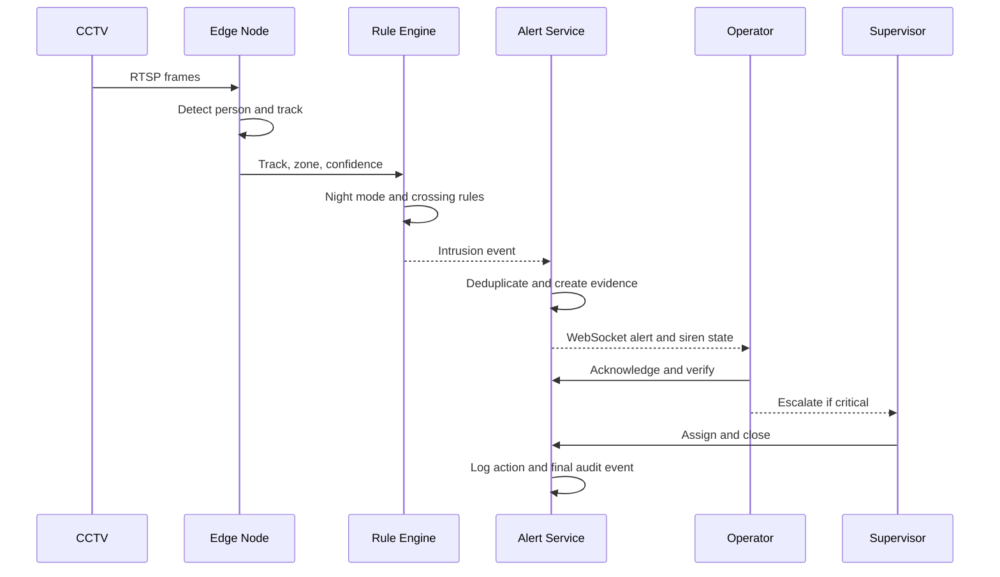

### 2.3 ANPR Watchlist Hit Journey

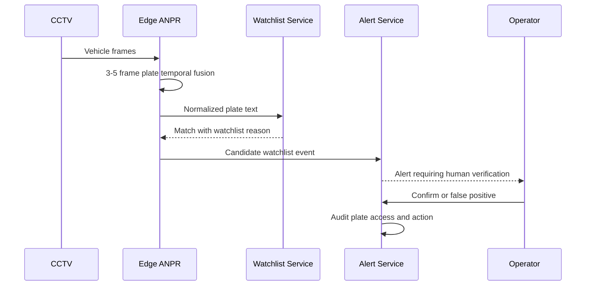

### 2.4 Face Watchlist Hit Journey

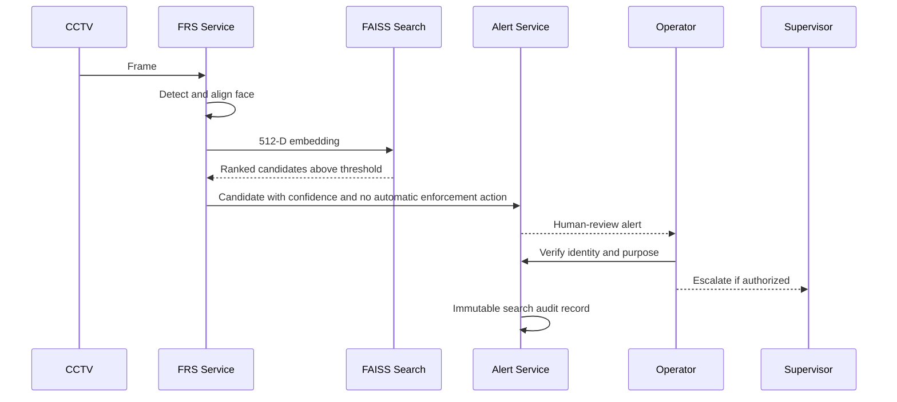

### 2.5 Loitering and Camera Failure Journeys

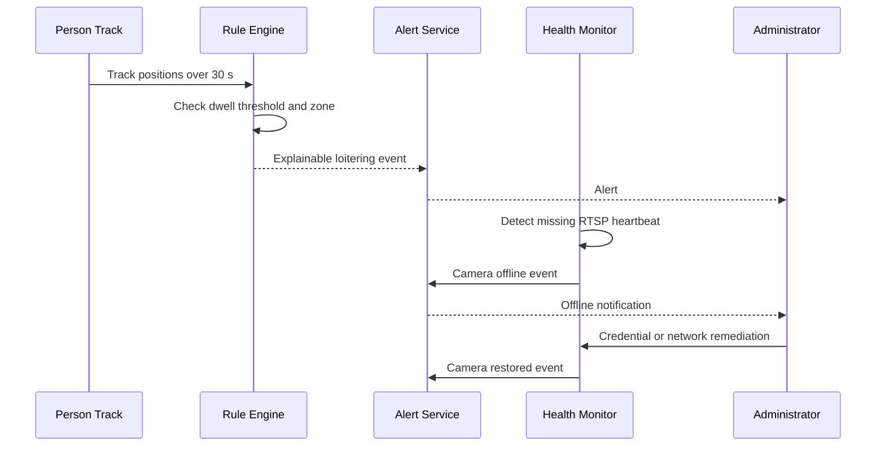

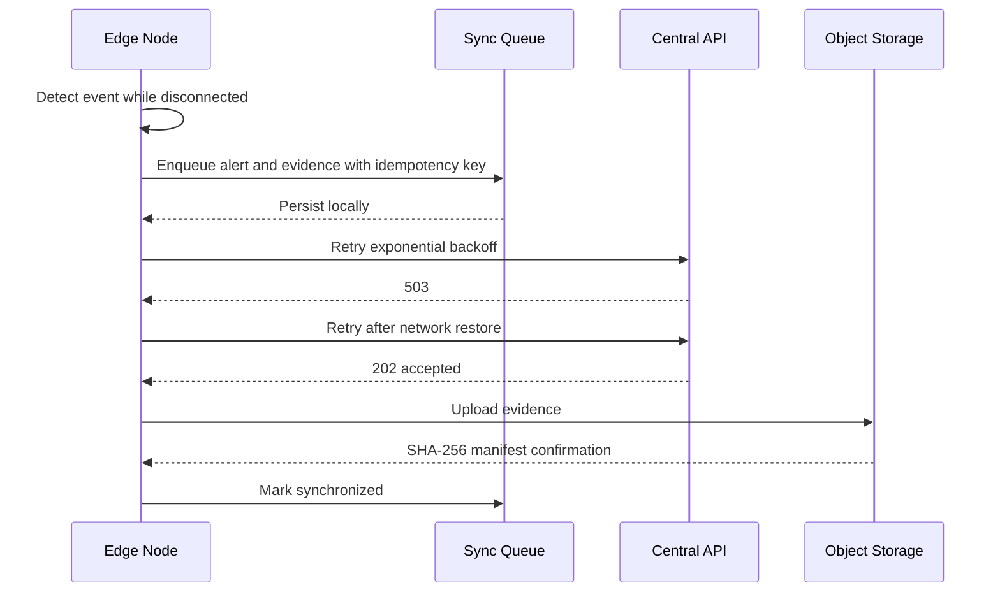

### 2.6 Evidence Verification Journey

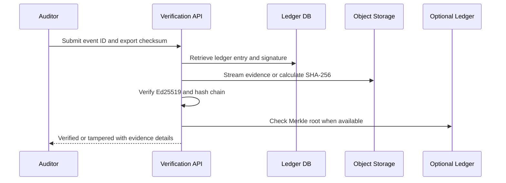

### 2.7 User-Story Catalogue

| Story ID | User story | Acceptance criteria |
|---|---|---|
| US-001 | As an operator, I want one prioritized alert feed. | Given an acknowledged alert, when another duplicate arrives within the configured cooldown, then only one active alert remains. |
| US-002 | As an operator, I want the reason an alert fired. | Given a rule event, when opened, then zone, track, thresholds, frame evidence, and rule version are visible. |
| US-003 | As a supervisor, I want to assign and escalate alerts. | Given a critical alert, when assigned, then assignee and transition are logged with timestamp and actor. |
| US-004 | As an analyst, I want plate search. | Given normalized plate text, when searching, then matching events are returned within 2 seconds for 100k records. |
| US-005 | As an administrator, I want camera onboarding. | Given valid RTSP credentials, when tested, then stream health becomes connected or a specific error is shown. |
| US-006 | As an administrator, I want safe reconnect. | Given a link outage, when restored, then the camera reconnects without duplicating event IDs. |
| US-007 | As an auditor, I want evidence verification. | Given a modified evidence file, when verified, then the API returns `integrity_status=invalid`. |
| US-008 | As an ML engineer, I want model promotion gates. | Given a model failing acceptance metrics, when promotion is requested, then it is blocked and test report is linked. |
| US-009 | As a security officer, I want MFA. | Given an administrator login, when MFA is not satisfied, then privileged APIs return 403. |
| US-010 | As a command viewer, I want GIS alert context. | Given a geo-tagged event, when opened, then site and camera position are shown on the map. |
| US-011 | As an operator, I want feedback capture. | Given an alert, when marked false positive, then model ID, frame, reason, and reviewer are stored. |
| US-012 | As an operator, I want offline status. | Given central disconnection, when local alerts occur, then the dashboard marks offline and queues remain visible. |

## PART 3 — Functional Requirements

### 3.1 Camera Onboarding and Management

**Purpose:** Add standard cameras, validate stream connectivity, maintain health, and coordinate cameras by site.

| Requirement | Priority | Testable acceptance criteria |
|---|---|---|
| FR-001 — ONVIF discovery | P0 | Given an enabled network interface, when discovery runs for <= 30 seconds, then reachable ONVIF cameras include IP, manufacturer, profile, and RTSP candidate. |
| FR-002 — Manual RTSP entry | P0 | Given rtsp:// or rtsps:// URL and credentials, when credentials are validated, then connection state becomes connected within 10 seconds or a classified error is returned. |
| FR-003 — Credential protection | P0 | Given a saved camera, when configuration is exported or displayed, then raw password is absent and only a masked reference is returned. |
| FR-004 — PTZ control | P1 | Given an ONVIF PTZ camera, when move and stop commands are sent, then continuous movement stops within 500 ms and actions are audited. |
| FR-005 — Camera heartbeat | P0 | Given no decodable frame for 10 seconds, then camera offline is raised once and recovery is raised once after three valid frames. |
| FR-006 — Reconnect backoff | P0 | Given repeated RTSP failure, then reconnect intervals increase from 2 to 30 seconds with jitter and stop only after manual disable or process stop. |
| FR-007 — Site grouping | P0 | Given 32 cameras, then each can belong to exactly one operational site and multiple optional groups. |
| FR-008 — Multi-camera coordination | P1 | Given the same person in overlapping views, then associated track observations include camera IDs and timestamps, while persistence is not required in P0. |

**Capture defaults:** RTSP TCP preferred, UDP permitted only for low-latency local networks, 1080p decode target, 12 FPS analytics target, keyframe interval 2 seconds, reconnect timeout 10 seconds. GStreamer/OpenCV capture is primary; VideoCapture is fallback. FFmpeg is used for evidence clip encoding.

### 3.2 Human and Vehicle Detection and Tracking

| Requirement | Priority | Testable acceptance criteria |
|---|---|---|
| FR-010 — Class-aware detection | P0 | Given a frame, when YOLO inference completes, then output contains person and vehicle detections with confidence, bbox, class, frame ID, timestamp, and model ID. |
| FR-011 — Configurable ROI | P0 | Given an ROI mask, when a detection box overlaps less than 25% of mask area, then no alert is generated by that ROI. |
| FR-012 — Minimum object size | P0 | Given a person bbox smaller than 16 pixels on the short edge, then it is discarded unless an explicit camera override allows it. |
| FR-013 — Non-maximum suppression | P0 | Given overlapping boxes above 0.55 IoU, then the lower-confidence duplicate is suppressed. |
| FR-014 — ByteTrack lifecycle | P0 | Given 3 consecutive detections, then track status becomes confirmed; after 30 lost frames, status becomes expired. |
| FR-015 — DeepSORT fallback | P1 | Given `tracker=deepsort`, then config-only restart loads DeepSORT and emits the same track JSON schema. |
| FR-016 — Cross-camera re-ID | P2 | Given overlapping cameras and appearance embeddings, then candidate matches include confidence and require operator confirmation. |
| FR-017 — Trajectory storage | P0 | Given a confirmed track, then timestamped ground-point samples are retained for 300 seconds in the hot store. |

**Detection defaults:** confidence 0.40, NMS IoU 0.55, confirmation 3 frames, lost-track TTL 30 frames. Each can be tuned per camera within confidence 0.20–0.90, NMS 0.30–0.80, confirmation 2–10.

### 3.3 Face Detection and Recognition

| Requirement | Priority | Testable acceptance criteria |
|---|---|---|
| FR-020 — Face detection | P1 | Given a face larger than 64x64 pixels and confidence >= 0.60, then a five-landmark-aligned 112x112 crop is produced. |
| FR-021 — Face embeddings | P1 | Given a valid crop, then the embedding is exactly 512 float32 values and L2-normalized. |
| FR-022 — FAISS search | P1 | Given `IndexFlatIP` or approved IVF variant, then ranking is cosine-sorted and every candidate includes similarity and watchlist ID. |
| FR-023 — Threshold calibration | P1 | Given the bench set, then deployment threshold is derived from FAR/FRR target and recorded in model metadata. |
| FR-024 — Watchlist enrollment | P1 | Given at least two consented or legally authorized images, then enrollment requires supervisor approval and an expiry date. |
| FR-025 — Human review | P1 | Given a candidate match, then no enforcement action is emitted and `human_confirmed=false` remains until authorized review. |
| FR-026 — Search audit | P1 | Given a face search, then actor, purpose, candidate, threshold, and timestamp are immutable in audit logs. |

### 3.4 ANPR

| Requirement | Priority | Testable acceptance criteria |
|---|---|---|
| FR-030 — Plate localization | P1 | Given a vehicle with plate, then plate bbox and plate confidence are returned. |
| FR-031 — Perspective correction | P1 | Given a skewed plate, then a 4-point perspective output is normalized to a 320x128 canvas. |
| FR-032 — OCR and confidence | P1 | Given OCR output, then normalized text and character-level confidence are returned. |
| FR-033 — Temporal fusion | P1 | Given 3–5 frames, then exact-match plate text is median/ensemble selected and weak outliers are discarded. |
| FR-034 — Indian plate validation | P1 | Given plate text, then accepted formats include two-letter state code, RTO, series, number, BH-series, and designated military/temporary formats. |
| FR-035 — Match alert | P1 | Given a valid watchlist match, then a candidate event requires operator verification and includes OCR confidence. |

Default plate pattern accepts `^[A-Z]{2}[0-9]{2}[A-Z]{1,2}[0-9]{4}$` for civilian plates, `^[0-9]{2}BH[0-9]{4}[A-Z]{1,2}$` for BH-series, and explicit military/temporary allowlists supplied by the deployment authority. These regexes are validation aids, not proof of legal validity.

### 3.5 Virtual Fence and Intrusion

| Requirement | Priority | Testable acceptance criteria |
|---|---|---|
| FR-040 — Zone editor | P0 | Given a frozen camera frame, when a line or polygon is drawn, then coordinates are stored as normalized image points and camera-specific version metadata. |
| FR-041 — Ground-point collision | P0 | Given a bbox, then intrusion uses the bottom-centre `(x_mid, y_bottom)` point rather than bbox centre. |
| FR-042 — Crossing direction | P0 | Given a line zone, then only configured direction(s) generate crossing alerts. |
| FR-043 — Homography | P1 | Given 4 calibration points, then a homography converts image points to deployed ground plane metres. |
| FR-044 — Dwell-in-zone | P0 | Given a person track inside polygon for >= 10 seconds, then loitering intrusion logic receives continuous dwell duration. |
| FR-045 — Zone schedule | P0 | Given zone schedule 22:00–06:00, then no zone trigger is created outside the schedule. |
| FR-046 — Zone versioning | P0 | Given a zone update, then prior geometry remains retained and every alert references `zone_version`. |

Roboflow and supervision `LineZone`/`PolygonZone` concepts may be used for geometry, but FALCON's authoritative zone JSON is stored in PostgreSQL.

### 3.6 Suspicious-Activity Detection

| Requirement | Priority | Formula/default/range |
|---|---|---|
| FR-050 — Dwell loitering | P1 | Alert when dwell >= 30 seconds inside zone or loiter radius, range 10–300 seconds. |
| FR-051 — Fence approach | P1 | Alert when track approaches a polygon/line within 2 m for >= 5 seconds with inward trajectory angle <= 45 degrees, range 1–20 m and 5–60 seconds. |
| FR-052 — Speed anomaly | P1 | Alert when 5-second smoothed speed is > mean + 3 MAD for the camera, range 1–10 MAD. |
| FR-053 — Group clustering | P1 | Alert when >= 4 confirmed person tracks are inside 5 m cluster radius for >= 10 seconds, range 2–20 persons and 3–30 m. |
| FR-054 — Group movement | P1 | Alert when >= 3 tracks move with cosine-aligned heading > 0.80 for >= 10 seconds. |
| FR-055 — Abandoned object | P1 | Candidate only; alert when a vehicle/person-created stationary object track remains outside normal zone >= 300 seconds and nearby person association expires, range 60–900 seconds. |
| FR-056 — Phase-2 pose | P2 | YOLO-pose/rules for climbing/crawling first; temporal action model only after 500 validated clips per class. |
| FR-057 — Drone/UAV head | P2 | Pluggable class head produces a bounding box and confidence; no core architecture change. |

Every suspicious event explanation lists rule ID, measured value, threshold, track ID, zone, duration, camera, and model/rule version. Operator feedback is required for abandoned-object alerts.

### 3.7 Night, Low-Light and Thermal Detection

| Requirement | Priority | Testable acceptance criteria |
|---|---|---|
| FR-060 — Automatic night mode | P1 | Given brightness < 25 lux-equivalent or scene luminance percentile < 18, then night pre-processing activates unless camera override is scheduled. |
| FR-061 — IR/thermal support | P1 | Given thermal or IR stream metadata, then grayscale normalization and thermal-compatible model variant are selected. |
| FR-062 — Degradation reporting | P1 | Given fog/rain/glare score above threshold, then inference confidence multiplier and degradation flag are included. |
| FR-063 — Degradation behavior | P1 | Given severe glare or rain, then the platform lowers expected false negatives and raises review state instead of silently alerting. |

### 3.8 Alert Engine

| Requirement | Priority | Testable acceptance criteria |
|---|---|---|
| FR-070 — Severity levels | P0 | Severity values are `info`, `low`, `medium`, `high`, `critical`; invalid values return 422. |
| FR-071 — Deduplication | P0 | Two alerts from the same track, rule, zone, and camera within cooldown are merged. |
| FR-072 — Cooldown | P0 | Default 30 seconds, configurable 5–3600 seconds per rule/camera. |
| FR-073 — Escalation | P0 | Unacknowledged high alerts escalate after 60 seconds; critical after 30 seconds. |
| FR-074 — Ack/verify/close | P0 | Alert state transitions are `new -> acknowledged -> escalated -> resolved -> closed` or `new -> false_positive -> closed`. |
| FR-075 — False-positive feedback | P0 | A false-positive label stores reason, operator, frame IDs, track ID, camera, model, and rule version. |
| FR-076 — Siren/relay | P1 | Siren/relay trigger requires role, approval policy, and signed action record; command timeout is 3 seconds. |
| FR-077 — Push channels | P0 | Alert delivery supports WebSocket, REST, webhook, MQTT, and Redis in the selected deployment. |
| FR-078 — Handover | P1 | Shift handover includes active, escalated, and unresolved alert counts. |

### 3.9 Event Logging and Evidence

| Requirement | Priority | Testable acceptance criteria |
|---|---|---|
| FR-080 — Snapshot evidence | P0 | Every alert stores an annotated snapshot with UTC timestamp and camera name or link. |
| FR-081 — Pre/post-roll clip | P0 | Every alert stores 10 seconds pre-roll and 10 seconds post-roll or records a precise clip-generation failure reason. |
| FR-082 — Search | P0 | Event search filters by camera, time, class, plate, zone, severity, and status and is paginated. |
| FR-083 — Export manifest | P1 | Export contains evidence files and SHA-256 manifest, signed metadata, and verification instructions. |
| FR-084 — Retention | P0 | Default hot 30 days, warm 180 days, archive 365 days; deployer-configurable retention cannot bypass legal hold. |
| FR-085 — Evidence links | P0 | Every evidence link expires within 15 minutes and authorization is rechecked. |

### 3.10 Cross-Cutting Model Operations

| Requirement | Priority | Testable acceptance criteria |
|---|---|---|
| FR-090 — Model registry | P0 | Model artifacts include name, version, licence, dataset hash, test report, architecture, exports, signature, and deployment status. |
| FR-091 — OTA update | P1 | Signed models update over HTTPS and report success, checksum mismatch, or rollback. |
| FR-092 — Air-gapped update | P1 | Offline package includes signature, model, SBOM, migration, checksum manifest, and rollback image. |
| FR-093 — Feedback dataset | P0 | Marked alerts create anonymized training candidates with original frame and label policy. |
| FR-094 — Analytics dashboard | P1 | Dashboard aggregates alert count, heatmap, camera uptime, false-positive rate, and median latency over selected ranges. |

## PART 4 — System Architecture

### 4.1 Logical Architecture

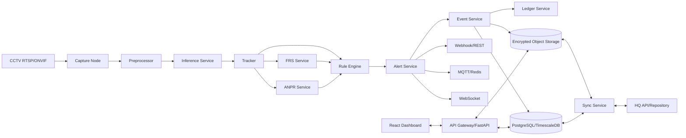

### 4.2 Component Specification

| Component | Responsibility | Inputs/Outputs | Framework | Scaling/failure |
|---|---|---|---|---|
| capture-node | Stream discovery, decode, timestamps, reconnect | RTSP/ONVIF -> raw/shared frames | Python, GStreamer/OpenCV, python-onvif-zeep | 1 process/camera group; restart by systemd; frame drop under load |
| preprocessor | Resize, denoise, grayscale/thermal normalization | Raw frames -> normalized frame | Python/OpenCV | GPU/CPU worker pool |
| inference-service | Person, vehicle, face, plate, thermal, UAV heads | Normalized frame -> detections | Ultralytics, ONNX Runtime, TensorRT/OpenVINO | Batch 1 or 1–4 according device; circuit breaker |
| tracker | IDs, trajectories, lost-track lifecycle | Detection + frame -> track | ByteTrack default/DeepSORT optional | Single ordered worker per stream |
| anpr-service | Plate crop, perspective, OCR, temporal fusion | Vehicle/track -> plate candidate | PaddleOCR primary/EasyOCR fallback | Independent queue; 100 ms target end-to-end |
| frs-service | Face crop, embedding, FAISS lookup | Face bbox -> candidate match | RetinaFace/InsightFace/ArcFace | Requires watchlist index; fail closed for uninitialized service |
| rule-engine | Fence, dwell, approach, speed, group, abandoned-object rules | Track/plate/face -> candidate events | Python | Stateless workers with Redis state; per-camera config |
| alert-service | Dedup, severity, escalation, acknowledgement | Candidate -> alert/action | FastAPI, MQTT/Redis | Durable queue; idempotent event key |
| event-service | Evidence, metadata, export, retention | Alert -> evidence/event | FastAPI | Queue-backed writes |
| api-gateway/backend | Auth, REST, RBAC, pagination | HTTP/WebSocket -> services | FastAPI | 2 replicas HQ; edge 1 replica |
| ledger-service | SHA-256 chain, signatures, Merkle roots | Evidence/event -> ledger entries | Python, Ed25519 | Store in DB; queue anchoring |
| sync-service | Queue, retry, conflict resolution | Edge -> HQ/object store | Python, MQTT/HTTP | Persistent queue and retry state |
| dashboard | Operator workflows and GIS | REST/WebSocket | React | CDN or local static edge host |
| model-registry | Model artifacts and promotion | Signed package -> registry | OCI-compatible storage/FastAPI | Read replicas and checksum validation |
| health-monitor | Heartbeats, resources, watchdog | Metrics/events -> status | Python, systemd | Local alarms survive HQ loss |

### 4.3 Processing Sequence

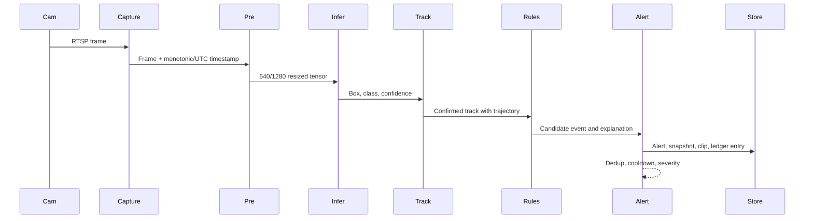

### 4.4 Latency Budget

| Stage | P95 target | P99 hard target |
|---|---|---|
| Capture/decode timestamp | <= 40 ms | <= 80 ms |
| Preprocess | <= 15 ms | <= 30 ms |
| Main person/vehicle inference | <= 70 ms at 12 FPS | <= 120 ms |
| Tracking | <= 10 ms | <= 20 ms |
| Rule evaluation | <= 15 ms | <= 30 ms |
| ANPR end-to-end branch | <= 100 ms | <= 180 ms |
| FRS branch | <= 150 ms | <= 300 ms |
| Snapshot and ledger write | <= 150 ms | <= 300 ms |
| Alert API/WebSocket fan-out | <= 200 ms | <= 400 ms |
| Frame-to-alert P95 | <= 1500 ms | 2500 ms |

Targets are not benchmark results and must be validated on chosen hardware.

### 4.5 Frame Drop and Backpressure

| Condition | Policy |
|---|---|
| Queue depth > 80% for 5 seconds | Skip every second analytics frame while continuing live display at decode FPS |
| Queue depth > 95% | Drop frames marked low priority; never drop confirmed track-close or alert evidence writes |
| Capture PTS jitter > 500 ms | Rebase stream timestamp and mark stream health degraded |
| GPU memory > 90% | Unload optional heads; preserve person/vehicle and rule engine |
| Disk free < 10% | Stop clip creation, preserve snapshots and metadata, raise critical capacity alert |
| Disk free < 5% | Freeze nonessential exports and initiate retention purge within legal hold constraints |

### 4.6 Message Schemas

**Detection message**

```json
{
  "schema_version": "1.0",
  "node_id": "uuid",
  "camera_id": "uuid",
  "frame_id": "123456",
  "captured_at": "2026-11-17T10:15:30.123Z",
  "model_id": "detector-yolov8n-001",
  "detections": [
    {"class": "person", "confidence": 0.91, "bbox_xyxy": [120, 200, 180, 420]}
  ]
}
```

**Track message**

```json
{
  "schema_version": "1.0",
  "camera_id": "uuid",
  "track_id": "cam12:482",
  "class": "person",
  "status": "confirmed",
  "ground_point": [150.4, 419.8],
  "timestamp": "2026-11-17T10:15:30.123Z"
}
```

**Alert message**

```json
{
  "schema_version": "1.0",
  "event_id": "uuid",
  "camera_id": "uuid",
  "severity": "high",
  "category": "virtual_fence",
  "title": "Person crossed north line",
  "explanation": {"rule_id": "VFR-1", "direction": "north", "track_id": "cam12:482"},
  "created_at": "2026-11-17T10:15:30.700Z",
  "idempotency_key": "edge-node-12:frame:482:VFR-1",
  "evidence": {"snapshot_id": "uuid", "clip_id": "uuid"}
}
```

### 4.7 Protocols and Topics

| Topic | Publisher | Consumer | QoS/Retention |
|---|---|---|---|
| `falcon/{site}/camera/{camera_id}/frame_status` | capture-node | health-monitor/dashboard | MQTT 0; no retention |
| `falcon/{site}/camera/{camera_id}/detections` | inference | tracker | Redis stream; 60-second trim |
| `falcon/{site}/tracks` | tracker | rule-engine, optional ANPR/FRS | MQTT 1 or Redis stream |
| `falcon/{site}/alerts/{severity}` | alert-service | dashboard/MQTT SOC | MQTT 1; HQ retained latest per alert |
| `falcon/{site}/health` | health-monitor | HQ/sync | MQTT 1; retained latest |
| `falcon/{site}/config/revision` | API | nodes | Retained by config broker |

REST is used for commands and transactions; WebSocket is used for live operator updates; MQTT is preferred for local alert fan-out; Redis Streams is an alternative and not active simultaneously in a deployment unless explicitly mirrored.

### 4.8 Offline Sync

- Every outbound transaction carries `idempotency_key`, `source_node_id`, `event_sequence`, and `created_at`.
- SQLite/embedded queue is used for edge queue persistence; Postgres sync queue is also retained for the central service.
- Outbound order follows event sequence per camera; independent streams may sync concurrently.
- Exponential retry starts at 5 seconds and doubles to 300 seconds with jitter.
- Alert and evidence object uploads are separate: metadata may return 202 before object upload; incomplete evidence is repaired by a sync worker.
- Conflict resolution favors HQ legal/audit records over edge copies; edge analytics events are append-only and never overwritten.
- Alert acknowledge actions use server-authoritative revision and last-modifier wins only for comments, with explicit conflict notification for state transitions.

### 4.9 Deployment Views

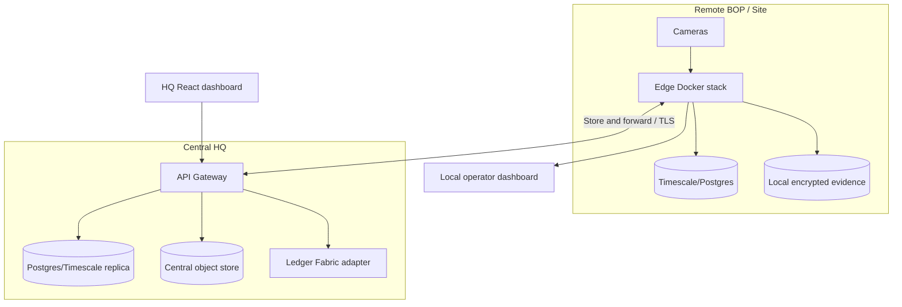

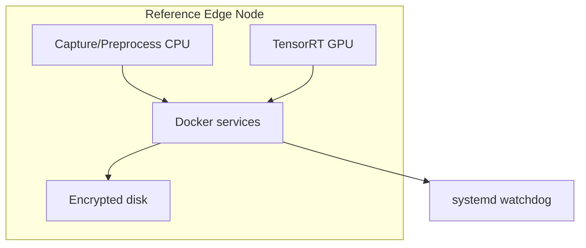

## PART 5 — Data and AI/ML Design

### 5.1 Model Table

| Model | Role/architecture | Input | Framework/export | License check | Device target |
|---|---|---|---|---|---|
| Main detector | YOLOv8s/v9 person/vehicle plus optional classes | 640 or 1280 | Ultralytics; ONNX Runtime/TensorRT FP16/INT8 | Ultralytics AGPL-3.0 implications; approved alternative or commercial license required | <= 70 ms P95 target |
| Vehicle classifier | EfficientNet or YOLO-cls car/truck/motorcycle | 224 | ONNX/TensorRT | Dataset and model license recorded | <= 15 ms |
| Tracker | ByteTrack | Bounding boxes/track state | Python | MIT/relevant tracker license recorded | <= 10 ms |
| DeepSORT | DeepSORT as selectable alternative | Box + appearance embedding | Python/ONNX | Model and code license recorded | <= 20 ms target |
| Face detector | RetinaFace 5-landmark | 640 or 112 aligned | ONNX/TensorRT | Source license to be verified | <= 30 ms |
| Face embedding | ArcFace/InsightFace 512-D | 112x112 | ONNX/TensorRT | Source license and trained-weight rights verified | <= 40 ms |
| Plate detector | YOLOv8-seg/detect plate bbox | 640 or tile | ONNX/TensorRT | AGPL review applies if Ultralytics | <= 25 ms |
| OCR | PaddleOCR primary; EasyOCR fallback | 320x128 | ONNX/Paddle; Torch fallback | Apache-2.0/PaddleOCR license check; EasyOCR license check | <= 50 ms |
| LPRNet/CRNN | Optional benchmarked model | 94x24 or 320x128 | ONNX/TensorRT | Source license verified | <= 30 ms target |
| Thermal/night | Fine-tuned YOLO person/vehicle | 640/1280 | ONNX/TensorRT FP16/INT8 | Source/license recorded | <= 80 ms target |
| Pose | YOLO-pose phase 2 | 640 | ONNX/TensorRT | AGPL review if Ultralytics | <= 80 ms target |
| Drone head | YOLO aircraft/UAV class | 640/1280 | ONNX/TensorRT | Source/license recorded | <= 80 ms target |

No third-party licence is treated as approved until the model, code, pretrained weight, and training dataset licenses are reviewed.

### 5.2 Datasets

| Data need | Sources/examples | Annotation plan |
|---|---|---|
| Person/vehicle | COCO, CrowdHuman, UA-DETRAC, approved self-collected BOP imagery | Person, car, truck, bus, motorcycle, bicycle; 3–5 annotator agreement |
| Face | WIDER FACE, WIDER; approved watchlist images only | Face bbox and 5 landmarks; do not use public identities for operational watchlists |
| Recognition | MS1M/Glint360K only after license review | Identity, consent/exemption, provenance, quality, pose |
| Plate | CCPD and approved Indian/self-collected plates | Plate bbox, quadrilateral, text, state, character boxes |
| Thermal/night | FLIR ADAS, LLVIP, KAIST, authorized thermal collection | Person/vehicle/day/night/rain/glare labels |
| UAV | VisDrone, approved aerial data | Drone/UAV bbox and small-object labels |
| Behaviour | Authorized CCTV sequences, synthetic and staged sequences | Dwell, line crossing, cluster, abandoned object, climbing/crawling for phase 2 |

Train/validation/test splits are camera-independent and temporally independent. No camera or site may appear in both validation and training. Exact accepted splits are 70/15/15 for initial fine-tuning, adjusted to preserve rare classes. Annotation tools: Roboflow for pseudo-products and export; CVAT or Label Studio for operational labelling. Augmentations cover fog, rain, glare, motion blur, JPEG compression, gain/noise, horizontal flip, brightness ±30%, resolution reduction, and thermal scale transforms.

### 5.3 Training Plan

- Transfer from COCO or approved pretrained weights.
- Main detector: SGD 0.01 learning rate, cosine schedule, 300 epochs maximum, early stop 20 epochs, multi-scale 480–1280.
- Face embedding: triplet or CosFace/ArcFace angular margin, 512-D output.
- OCR: character-balanced batch sampling, synthetic font/rendering augmentation, plate-format augmentation.
- Use MLflow or equivalent experiment tracking, immutable dataset hash, git commit, container digest, hyperparameters, seeds, and metrics.
- Data leakage checks reject duplicate clips, near-duplicate frames, and cross-camera overlap.

### 5.4 Evaluation

| Capability | Metrics | Acceptance target |
|---|---|---|
| Detection | mAP@0.5, mAP@0.5:0.95, precision, recall | Target: 0.90/0.85/0.85 person and 0.92/0.90/0.90 vehicle on held-out set |
| Tracking | MOTA, IDF1, ID switches | Target: 0.85 MOTA, 0.80 IDF1, < 3 switches/100 ground-truth track-minutes |
| Plate | Exact match, character accuracy, E2E latency | Target: >= 95% exact match and 99% character on held-out Indian-format set |
| OCR character confidence | ECE or confidence reliability curve | 15% maximum Brier/ECE gap to be measured |
| FRS | FAR, FRR, TAR, ROC-AUC | Threshold chosen at operational FAR; target to be measured |
| Behaviour | Precision/recall, alert distance | >= 90% precision for virtual fence in staged benchmark |
| Night/thermal | mAP and recall | No target above achieved benchmark until field data is available |

### 5.5 False-Positive Reduction

Use class-aware filtering, 3-frame track confirmation, static false-alarm masks, temporal stability, camera calibration, severity caps, cooldown, and human feedback. Animal detections are not classed as persons/vehicles and should not become events unless an optional animal head is explicitly enabled.

### 5.6 Drift and Retraining

Daily metrics include false-positive rate, OCR exact-match, face reject/accept distribution, camera-level recall proxy, confidence distribution, and daylight/night ratio. Retraining is triggered after 7-day drift > 10% relative, 500 operator-reviewed samples, or known environment change. Any model upgrade requires replay against a fixed regression suite.

### 5.7 Inference Optimization

- Export detector and head weights to ONNX FP32 then validate FP16/INT8.
- TensorRT is the primary NVIDIA runtime; OpenVINO is the primary Intel NUC option.
- Batch inference is disabled for latency-critical live streams unless benchmark proves P95 improvement.
- Frame skipping policy is 12 FPS analytics with 25/30 FPS display decode.
- Small-object tiling is used for plate/distant-object regions when camera height and resolution justify it.
- Optional heads are unloaded when GPU memory or queue pressure exceeds policy.

## PART 6 — Data Model and APIs

### 6.1 ER Diagram

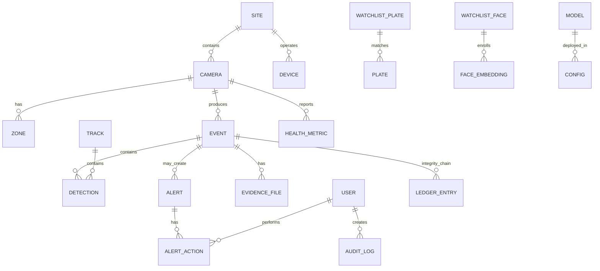

### 6.2 PostgreSQL and TimescaleDB DDL

```sql
CREATE EXTENSION IF NOT EXISTS timescaledb;
CREATE EXTENSION IF NOT EXISTS pgcrypto;

CREATE TABLE sites (
  id UUID PRIMARY KEY DEFAULT gen_random_uuid(),
  name TEXT NOT NULL,
  code TEXT UNIQUE NOT NULL,
  latitude NUMERIC(9,6),
  longitude NUMERIC(9,6),
  timezone TEXT NOT NULL DEFAULT 'Asia/Kolkata',
  created_at TIMESTAMPTZ NOT NULL DEFAULT now()
);

CREATE TABLE cameras (
  id UUID PRIMARY KEY DEFAULT gen_random_uuid(),
  site_id UUID NOT NULL REFERENCES sites(id),
  name TEXT NOT NULL,
  rtsp_url TEXT,
  credential_ref TEXT NOT NULL,
  onvif_profile TEXT,
  status TEXT NOT NULL DEFAULT 'disconnected',
  latitude NUMERIC(9,6),
  longitude NUMERIC(9,6),
  config JSONB NOT NULL DEFAULT '{}',
  enabled BOOLEAN NOT NULL DEFAULT true,
  created_at TIMESTAMPTZ NOT NULL DEFAULT now()
);

CREATE TABLE zones (
  id UUID PRIMARY KEY DEFAULT gen_random_uuid(),
  camera_id UUID NOT NULL REFERENCES cameras(id),
  name TEXT NOT NULL,
  type TEXT NOT NULL CHECK (type IN ('line','polygon')),
  geometry JSONB NOT NULL,
  schedule JSONB NOT NULL DEFAULT '{"all_day":true}',
  version INTEGER NOT NULL DEFAULT 1,
  effective_at TIMESTAMPTZ NOT NULL,
  retired_at TIMESTAMPTZ,
  UNIQUE(camera_id, name, version)
);

CREATE TABLE users (
  id UUID PRIMARY KEY DEFAULT gen_random_uuid(),
  subject TEXT UNIQUE NOT NULL,
  display_name TEXT NOT NULL,
  role TEXT NOT NULL,
  mfa_required BOOLEAN NOT NULL DEFAULT true,
  active BOOLEAN NOT NULL DEFAULT true,
  created_at TIMESTAMPTZ NOT NULL DEFAULT now()
);

CREATE TABLE roles (
  id SMALLSERIAL PRIMARY KEY,
  name TEXT UNIQUE NOT NULL,
  permissions JSONB NOT NULL
);

CREATE TABLE events (
  id UUID PRIMARY KEY,
  node_id UUID NOT NULL,
  camera_id UUID NOT NULL REFERENCES cameras(id),
  zone_id UUID REFERENCES zones(id),
  track_id TEXT,
  category TEXT NOT NULL,
  severity TEXT NOT NULL,
  status TEXT NOT NULL DEFAULT 'new',
  explanation JSONB NOT NULL,
  captured_at TIMESTAMPTZ NOT NULL,
  created_at TIMESTAMPTZ NOT NULL DEFAULT now()
);
SELECT create_hypertable('events','captured_at',if_not_exists=>true);

CREATE TABLE detections (
  id BIGSERIAL PRIMARY KEY,
  event_id UUID REFERENCES events(id),
  camera_id UUID NOT NULL REFERENCES cameras(id),
  track_id TEXT,
  class TEXT NOT NULL,
  confidence REAL NOT NULL,
  bbox JSONB NOT NULL,
  frame_id TEXT NOT NULL,
  detected_at TIMESTAMPTZ NOT NULL
);
SELECT create_hypertable('detections','detected_at',if_not_exists=>true);

CREATE TABLE tracks (
  id TEXT PRIMARY KEY,
  camera_id UUID NOT NULL REFERENCES cameras(id),
  class TEXT NOT NULL,
  status TEXT NOT NULL,
  started_at TIMESTAMPTZ NOT NULL,
  ended_at TIMESTAMPTZ,
  trajectory JSONB NOT NULL
);

CREATE TABLE alerts (
  id UUID PRIMARY KEY DEFAULT gen_random_uuid(),
  event_id UUID UNIQUE NOT NULL REFERENCES events(id),
  severity TEXT NOT NULL,
  cooldown_until TIMESTAMPTZ,
  assigned_to UUID REFERENCES users(id),
  status TEXT NOT NULL DEFAULT 'new',
  idempotency_key TEXT UNIQUE NOT NULL,
  created_at TIMESTAMPTZ NOT NULL DEFAULT now()
);

CREATE TABLE alert_actions (
  id BIGSERIAL PRIMARY KEY,
  alert_id UUID NOT NULL REFERENCES alerts(id),
  actor_id UUID NOT NULL REFERENCES users(id),
  action TEXT NOT NULL,
  reason TEXT,
  acted_at TIMESTAMPTZ NOT NULL DEFAULT now()
);

CREATE TABLE watchlist_plates (
  id UUID PRIMARY KEY DEFAULT gen_random_uuid(),
  normalized_plate TEXT NOT NULL UNIQUE,
  jurisdiction TEXT,
  reason TEXT NOT NULL,
  expiry_at TIMESTAMPTZ NOT NULL,
  approved_by UUID REFERENCES users(id),
  active BOOLEAN NOT NULL DEFAULT true
);

CREATE TABLE watchlist_faces (
  id UUID PRIMARY KEY DEFAULT gen_random_uuid(),
  subject_label TEXT NOT NULL,
  legal_basis TEXT NOT NULL,
  consent_ref TEXT,
  expiry_at TIMESTAMPTZ NOT NULL,
  approved_by UUID REFERENCES users(id),
  active BOOLEAN NOT NULL DEFAULT true
);

CREATE TABLE face_embeddings (
  id UUID PRIMARY KEY DEFAULT gen_random_uuid(),
  watchlist_face_id UUID NOT NULL REFERENCES watchlist_faces(id),
  embedding_vector BYTEA NOT NULL,
  embedding_dim SMALLINT NOT NULL DEFAULT 512,
  quality REAL NOT NULL,
  faiss_index_id TEXT
);

CREATE TABLE evidence_files (
  id UUID PRIMARY KEY DEFAULT gen_random_uuid(),
  event_id UUID NOT NULL REFERENCES events(id),
  kind TEXT NOT NULL CHECK (kind IN ('snapshot','clip','manifest')),
  object_key TEXT NOT NULL UNIQUE,
  sha256 CHAR(64) NOT NULL,
  size_bytes BIGINT NOT NULL,
  encrypted BOOLEAN NOT NULL DEFAULT true,
  legal_hold BOOLEAN NOT NULL DEFAULT false,
  created_at TIMESTAMPTZ NOT NULL DEFAULT now()
);

CREATE TABLE ledger_entries (
  id UUID PRIMARY KEY DEFAULT gen_random_uuid(),
  event_id UUID NOT NULL REFERENCES events(id),
  evidence_sha256 CHAR(64) NOT NULL,
  metadata_sha256 CHAR(64) NOT NULL,
  prev_hash CHAR(64),
  entry_hash CHAR(64) UNIQUE NOT NULL,
  ed25519_signature BYTEA NOT NULL,
  signer_node_id UUID NOT NULL,
  merkle_root CHAR(64),
  anchor_status TEXT NOT NULL DEFAULT 'pending',
  anchored_at TIMESTAMPTZ,
  created_at TIMESTAMPTZ NOT NULL DEFAULT now()
);

CREATE TABLE audit_logs (
  id BIGSERIAL PRIMARY KEY,
  actor_id UUID,
  action TEXT NOT NULL,
  resource_type TEXT NOT NULL,
  resource_id TEXT,
  purpose TEXT,
  details JSONB NOT NULL,
  ip_address INET,
  created_at TIMESTAMPTZ NOT NULL DEFAULT now()
);

CREATE TABLE models (
  id UUID PRIMARY KEY DEFAULT gen_random_uuid(),
  name TEXT NOT NULL,
  version TEXT NOT NULL,
  architecture TEXT NOT NULL,
  licence TEXT NOT NULL,
  artifact_sha256 CHAR(64) NOT NULL,
  dataset_hash CHAR(64),
  test_report JSONB NOT NULL,
  status TEXT NOT NULL,
  signed_at TIMESTAMPTZ,
  UNIQUE(name,version)
);

CREATE TABLE configs (
  id UUID PRIMARY KEY DEFAULT gen_random_uuid(),
  camera_id UUID REFERENCES cameras(id),
  zone_id UUID REFERENCES zones(id),
  revision INTEGER NOT NULL,
  body JSONB NOT NULL,
  approved_by UUID REFERENCES users(id),
  created_at TIMESTAMPTZ NOT NULL DEFAULT now()
);

CREATE TABLE devices (
  id UUID PRIMARY KEY DEFAULT gen_random_uuid(),
  site_id UUID NOT NULL REFERENCES sites(id),
  hostname TEXT NOT NULL,
  hardware_profile TEXT NOT NULL,
  software_version TEXT NOT NULL,
  secure_boot BOOLEAN NOT NULL DEFAULT false,
  disk_encrypted BOOLEAN NOT NULL DEFAULT false,
  last_seen TIMESTAMPTZ
);

CREATE TABLE health_metrics (
  device_id UUID NOT NULL REFERENCES devices(id),
  camera_id UUID REFERENCES cameras(id),
  metric_name TEXT NOT NULL,
  metric_value DOUBLE PRECISION NOT NULL,
  sampled_at TIMESTAMPTZ NOT NULL
);
SELECT create_hypertable('health_metrics','sampled_at',if_not_exists=>true);

CREATE TABLE sync_queue (
  id BIGSERIAL PRIMARY KEY,
  idempotency_key TEXT UNIQUE NOT NULL,
  source_node_id UUID NOT NULL,
  event_sequence BIGINT NOT NULL,
  payload_type TEXT NOT NULL,
  payload JSONB NOT NULL,
  status TEXT NOT NULL DEFAULT 'pending',
  attempt_count SMALLINT NOT NULL DEFAULT 0,
  next_attempt_at TIMESTAMPTZ,
  created_at TIMESTAMPTZ NOT NULL DEFAULT now()
);

CREATE INDEX idx_events_camera_time ON events(camera_id,captured_at DESC);
CREATE INDEX idx_events_category ON events(category,captured_at DESC);
CREATE INDEX idx_alert_status ON alerts(status,severity,created_at DESC);
CREATE INDEX idx_audit_resource ON audit_logs(resource_type,resource_id,created_at DESC);
CREATE INDEX idx_sync_pending ON sync_queue(status,next_attempt_at);
CREATE INDEX idx_detections_camera_time ON detections(camera_id,detected_at DESC);

ALTER TABLE events SET (timescaledb.compress, timescaledb.compress_segmentby='camera_id');
SELECT add_retention_policy('events', INTERVAL '365 days');
SELECT add_compression_policy('events', INTERVAL '7 days');
SELECT add_retention_policy('detections', INTERVAL '30 days');
SELECT add_compression_policy('detections', INTERVAL '24 hours');
```

The DDL above defines the baseline relational schema.

| DB requirement | Priority | Acceptance criteria |
|---|---|---|
| DB-001 — Time-series partitioning | P0 | Given events/detections/health rows, then corresponding Timescale hypertables and retention/compression policies exist. |
| DB-002 — Append-only ledger | P0 | Given a ledger entry, then only the verified append API can create it and direct hash-chain rewrites are blocked by audit policy. |
| DB-003 — Sync deduplication | P0 | Given the same idempotency key 100 times, then exactly one event and one evidence manifest exist. |
| DB-004 — Retention and legal hold | P0 | Given expired evidence with legal hold false, then retention purge removes it; legal hold blocks purge. |

### 6.3 Object Storage Layout

```text
evidence/{site_code}/{camera_id}/{YYYY}/{MM}/{DD}/{event_id}/snapshot.jpg
evidence/{site_code}/{camera_id}/{YYYY}/{MM}/{DD}/{event_id}/clip.mp4
evidence/{site_code}/{camera_id}/{YYYY}/{MM}/{DD}/{event_id}/manifest.json
exports/{user_id}/{YYYY}/{MM}/{export_id}.zip
models/{model_name}/{version}/{artifact}.{onnx|engine|pt}
feedback/{model_name}/{YYYY}/{MM}/{event_id}/{sample_id}.jpg
```

Files use AES-256 server-side encryption or edge disk encryption, TLS 1.2+, signed download URLs valid 15 minutes, checksum in metadata, and object lock for legal holds.

### 6.4 REST API Baseline

All APIs use `Authorization: Bearer`, `X-Node-Id` for edge writes, `Idempotency-Key` for mutations, `X-Request-ID`, API v1 prefix `/api/v1`, RFC 7807 errors, cursor or page/size pagination with default 50 and maximum 200. Mutations return 202 where evidence/object upload is asynchronous. Rate limits: operator 300 rpm, model admin 60 rpm, webhooks 1000 rpm per integration.

```json
{
  "error": {
    "code": "CAMERA_NOT_FOUND",
    "message": "Camera does not exist.",
    "request_id": "uuid",
    "field_errors": []
  }
}
```

| API ID | Endpoint | Method | Responsibility |
|---|---|---|---|
| API-001 | `/auth/login` | POST | OAuth2/password or federated login; sets short-lived access and secure refresh token |
| API-002 | `/auth/mfa/verify` | POST | MFA challenge for privileged roles |
| API-003 | `/cameras` | GET/POST | List or create cameras |
| API-004 | `/cameras/{id}` | GET/PATCH/DELETE | Read, update, or disable a camera |
| API-005 | `/cameras/discover` | POST | ONVIF discovery |
| API-006 | `/cameras/{id}/test` | POST | Validate RTSP/ONVIF credentials and stream |
| API-007 | `/cameras/{id}/ptz` | POST | Authenticated PTZ command |
| API-008 | `/cameras/{id}/health` | GET | Last frame, reconnect count, CPU/GPU/disk metrics |
| API-009 | `/zones` | GET/POST | Zone CRUD |
| API-010 | `/zones/{id}/activate` | POST | Activate a zone version |
| API-011 | `/events` | GET | Filtered, paginated event search |
| API-012 | `/events/{id}` | GET | Event detail and explanation |
| API-013 | `/events/{id}/feedback` | POST | True/false-positive feedback |
| API-014 | `/alerts` | GET/POST | Alert inbox and integration creation |
| API-015 | `/alerts/{id}/actions` | POST | Ack, assign, escalate, resolve, false-positive, close |
| API-016 | `/plates/search` | POST | Normalized plate search with purpose and audit |
| API-017 | `/faces/watchlists` | POST/GET | Governed face watchlist management |
| API-018 | `/faces/search` | POST | Candidate-only face search; never autonomous enforcement |
| API-019 | `/evidence/{event_id}/snapshot` | GET | Expiring signed snapshot link |
| API-020 | `/evidence/{event_id}/clip` | GET | Expiring signed clip link |
| API-021 | `/evidence/{event_id}/verify` | POST | Hash, signature, chain and optional anchor verification |
| API-022 | `/evidence/export` | POST | Signed evidence export with manifest |
| API-023 | `/models` | GET/POST | Registry listing and package promotion request |
| API-024 | `/models/{id}/promote` | POST | Promote after tests and signature |
| API-025 | `/health/nodes` | GET | Node/device health |
| API-026 | `/users` | GET/POST/PATCH | User lifecycle |
| API-027 | `/roles` | GET/PATCH | RBAC role assignment |
| API-028 | `/audit` | GET | Audit records, purpose and resource filters |
| API-029 | `/analytics/alerts` | GET | Counts, false-positive rate and latency |
| API-030 | `/analytics/heatmap` | GET | Geo/time heatmap aggregates |

Each endpoint must enforce the role matrix in Section 7 and return 401 unauthenticated, 403 unauthorized, 404 absent/not authorized, 409 state conflict, 422 invalid input, 429 rate limit, and 503 offline/degraded.

### 6.5 WebSocket Contract

Channel `/ws/v1/operator` authenticates with a short-lived token and subscribes to `alert.created`, `alert.updated`, `camera.status`, `node.health`, and `sync.pending`. Payload is `{channel, resource_id, sequence, event, data, occurred_at}`. The client resynchronizes by REST after gap or 30-second heartbeat timeout.

### 6.6 Webhook Contract

```json
{
  "event": "falcon.alert.created",
  "event_id": "uuid",
  "created_at": "2026-11-17T10:15:30Z",
  "data": {"alert_id": "uuid", "severity": "high", "category": "virtual_fence"},
  "signature": "HMAC-SHA256(hex)"
}
```

Retry schedule is 5s, 30s, 2m, 10m, 30m for 5 attempts. Payload includes `X-Falcon-Signature`, `X-Falcon-Timestamp`, and monotonic `X-Falcon-Delivery-Id`. Receiver tolerance is 5 minutes. Failed delivery is visible in integration health.

### 6.7 Interoperability

REST and webhook integrate C2/SOC. Optional CEF/syslog export provides timestamp, host, severity, category, event ID, camera, and source address. ONVIF Profiles S/T are used for discovery and PTZ where supported. VMS/C4I integration is adapter-based and must not require FALCON to own video storage.

## PART 7 — Security, Privacy and Compliance

### 7.1 Security Architecture

FALCON uses zero-trust network boundaries, short-lived JWT/OAuth2 access tokens (15 minutes), rotating refresh tokens (24 hours), mTLS for edge-to-service and site-to-HQ traffic, AES-256 at rest, TLS 1.2+ in transit, secure boot and full-disk encryption for edge nodes, and hardware-rooted keys where available.

### 7.2 Threat Model

| Threat ID | STRIDE | Threat | Mitigation | Test |
|---|---|---|---|---|
| TM-001 | Spoofing | Stolen RTSP credential or camera identity | Vault credentials, rtsps, cert pinning, camera allowlist | Replay and forged-device test |
| TM-002 | Tampering | Evidence/metadata modification | SHA-256, chain, Ed25519 signature, object immutability | Independent tamper verification |
| TM-003 | Repudiation | Operator denies alert action | Signed actor/session audit, MFA, immutable logs | Audit chain replay |
| TM-004 | Information disclosure | Face/plate evidence leakage | RBAC, purpose, masked APIs, encrypted storage | Penetration test and access audit |
| TM-005 | Denial of Service | Stream flood or queue exhaustion | Per-camera quotas, backpressure, CPU limits, frame drop | 100-stream flood test |
| TM-006 | Elevation of privilege | Service account gains admin | Least privilege, service identities, separate secrets | Negative authorization tests |

### 7.3 RBAC Matrix

| Resource/action | Operator | Supervisor | Analyst | Admin | ML Maintainer | Auditor |
|---|---|---|---|---|---|---|
| Live/camera view | Read | Read | Read limited | Read | Read | Read audit |
| Alert acknowledge/resolve | Own permitted | All | No | Read | No | No |
| Alert assign/escalate | No | Yes | No | Yes | No | No |
| Zone edit | No | Request | No | Yes | No | No |
| Watchlist edit | No | Approve | Create if authorized | Yes | Limited view | Read |
| Face/plate search | Limited | Limited | Purpose-required | Limited | No | Read |
| Model promote | No | No | No | Limited | Request/promote test | Read |
| User/role manage | No | No | No | Yes | No | No |
| Audit verify | No | Read own shift | Read investigation | Read | Read own model | Full |

### 7.4 Secrets and Artefacts

RTSP passwords and signing keys are kept outside Git in a vault or OS keyring. Key rotation occurs every 90 days for service keys and 180 days for signing keys unless policy requires shorter. Software, Docker images, and models are signed and verified against SBOM digests. Docker images run non-root, use read-only roots, restricted capabilities, seccomp, and no shell in runtime images.

### 7.5 Evidence Integrity Ledger

- MVP P0: canonical event JSON plus evidence SHA-256; `prev_hash = SHA256(previous entry)`, node Ed25519 signature, database transaction append.
- P1: append-only batch tree builds Merkle root every 6 hours or 1000 entries; root is signed and store-and-forwarded.
- P2: permissioned Hyperledger Fabric ledger receives Merkle roots and timestamp/anchor metadata, never raw video or identity biometrics.
- Verification first checks evidence hash, Ed25519 signature, chain continuity, and optional external anchor.
- Ledger does not claim external authority over the source database unless the external anchor verifies.

### 7.6 Privacy and Compliance

Face and plate data are minimized to operational purpose, with watchlist expiry (default 180 days), purpose binding, subject/authority governance, access justification, and retention limits. Every face/plate search is audited. FALCON does not infer sensitive traits or identity outside authorized watchlists. Deployment must confirm India DPDP Act 2023 applicability and security-agency exemptions through qualified counsel. The system maps to IT Act controls, CERT-In incident reporting requirements, MHA/BSF policies when applicable, and ISO 27001 controls as an implementation reference.

### 7.7 Data Retention

Default events 365 days, detections 30 days, alerts 365 days, snapshots/clips 180 days, audit logs 7 years, face embeddings 180 days or watchlist expiry, and feedback samples 365 days. Legal holds suspend deletion. Deleted data removal includes primary DB, replicas, object versions, export caches, and vector indexes; deletion jobs produce audit proof.

### 7.8 Resilience and Cybersecurity Operations

RPO is 15 minutes for central metadata and 24 hours for evidence at HQ; RTO is 4 hours for HQ and 30 minutes for the edge core pipeline. Backups are daily, encrypted, tested monthly, and disconnected from operator credentials. Cameras and nodes are segmented from operator and public networks. Air-gapped updates require signed package, offline SBOM, rollback image, and authorized dual control.

| Security requirement | Priority | Acceptance criteria |
|---|---|---|
| SEC-001 — Transport security | P0 | Given a deployed connection, then TLS is 1.2+ and edge service-to-service traffic uses mTLS. |
| SEC-002 — Privileged MFA | P0 | Given an admin or model-maintainer login, then privileged access fails until MFA verification succeeds. |
| SEC-003 — Least privilege | P0 | Given a negative authorization test, then the unauthorized API returns 403 and writes audit evidence. |
| SEC-004 — Secret custody | P0 | Given repository export, then camera passwords and signing keys are absent and only key references remain. |
| SEC-005 — Signed artefacts | P0 | Given a modified Docker image or model, then checksum or signature verification prevents startup/promotion. |
| SEC-006 — Evidence append chain | P0 | Given two consecutive evidence entries, then the second `prev_hash` equals the exact previous `entry_hash`. |
| SEC-007 — Deletion | P1 | Given approved deletion, then primary, replica, object and vector copies are removed or quarantined within policy and audited. |

## PART 8 — UI/UX Requirements

### 8.1 Information Architecture

The React dashboard has Live Wall, Cameras, GIS Map, Alerts, Events, Evidence, Zones, Watchlists, Analytics, Devices, Models, Users/Roles, Audit, and Settings. Mobile or narrow screens preserve acknowledge, verify, escalate, and search workflows.

| Screen | Required content and actions |
|---|---|
| Login | MFA, token expiry, offline message, accessible language switch |
| Live wall | Grid of camera streams, status, latency, selected stream, freeze and mute controls |
| Camera detail | Health, PTZ, crop/ROI, zone list, recent alerts |
| GIS map | Geo-tagged live alerts, site health, map and list synchronized |
| Alert inbox | Severity, state, camera, category, age, assignee, evidence thumbnail |
| Evidence viewer | Pre/post clip, snapshot, bbox, rule explanation, integrity badge |
| Zone editor | Frozen frame, line/polygon drawing, schedule, direction, version preview |
| Watchlist manager | Plate/face item, legal basis, expiry, approval, audit state |
| ANPR/FRS results | OCR confidence/characters or face candidate similarity; human decision |
| Analytics | Alert count, heatmap, uptime, false-positive rate, latency |
| Device health | CPU/GPU/RAM/disk/network, sync queue, reconnect, service status |
| Model management | Version, metrics, license, signature, staged/active status |
| User/role admin | Users, MFA, role mapping, last login |
| Audit log | Actor, action, purpose, resource, IP, result |
| Settings | Retention, thresholds, notifications, languages, escalation |

### 8.2 Wireframe

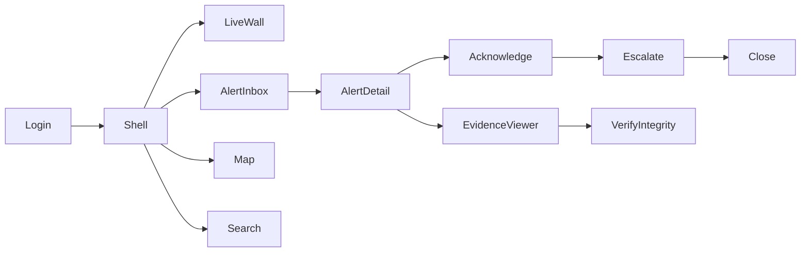

### 8.3 Component States and Accessibility

The UI must provide loading skeletons, empty states, local/offline banners, retry controls, destructive-action confirmation, and non-technical error descriptions. Accessibility target WCAG 2.1 AA: keyboard navigation, visible focus, 4.5:1 text contrast, reduced-motion mode, status announcements, and no color-only alert meaning. Severity is named and icon-coded. The interface supports English and Hindi with fallback to English for model/legal text.

### 8.4 Control-Room UX

Dark/night mode is default in Live Wall and Alert Inbox. Notification sound may escalate by severity and is muteable. Keyboard shortcuts include `A` acknowledge, `E` escalate, `F` false positive, `C` close, `/` search, and `?` shortcut list. Live list refresh is <= 2 seconds, filter response <= 1 second for 100k event records, and the dashboard remains usable with 256 kbps edge uplink.

| UI ID | Requirement | Priority | Acceptance criteria |
|---|---|---|---|
| UI-001 | Login/MFA | P0 | Given no valid MFA for admin, then privileged page is unavailable. |
| UI-002 | Live wall | P0 | Given 16 cameras, then every selected tile updates at <= 2-second UI delay. |
| UI-003 | Alert workflow | P0 | Acknowledge -> verify -> escalate -> close must require no more than 4 primary clicks. |
| UI-004 | Evidence integrity badge | P0 | Invalid evidence is red and never labeled verified. |
| UI-005 | Zone editor | P0 | Given unsaved geometry, then navigation prompts for discard or save. |
| UI-006 | Low-bandwidth mode | P1 | Given 256 kbps link, then snapshots and metadata load and clips are explicitly deferred. |

## PART 9 — Non-Functional Requirements

| Requirement ID | Category | Priority | Testable acceptance criteria |
|---|---|---|---|
| NFR-001 | Detection throughput | P0 | On reference node, 4x1080p streams at 12 FPS remain within 80% CPU/GPU sustained for 30 minutes. |
| NFR-002 | Alert latency | P0 | P95 frame-to-acknowledgable alert <= 1500 ms in benchmark environment. |
| NFR-003 | API latency | P0 | P95 GET event detail <= 500 ms and search <= 2 seconds for 100k rows. |
| NFR-004 | Availability | P0 | Edge core pipeline 99.5% monthly excluding planned maintenance. |
| NFR-005 | Camera recovery | P0 | 95% of reconnects complete within 30 seconds after restored link. |
| NFR-006 | Offline operation | P0 | Detection and local alerting continue for 72 hours with HQ disconnected. |
| NFR-007 | Queue durability | P0 | 1000 queued events survive process and edge reboot. |
| NFR-008 | Storage | P0 | 10% disk headroom alert, 5% safe mode, and no silent evidence loss. |
| NFR-009 | Scalability | P1 | A 16-node HQ ingest test completes with linear CPU scaling within 20% variance. |
| NFR-010 | Locales | P1 | English/Hindi UI text can switch without re-login or data loss. |
| NFR-011 | Security service | P0 | 100% privileged APIs require authorization and MFA policy. |
| NFR-012 | Observability | P0 | Logs/metrics/traces include node, camera, frame, event, and request correlation IDs. |
| NFR-013 | Restarts | P0 | systemd restarts crashed core service within 10 seconds and preserves event queue. |
| NFR-014 | Power loss | P1 | PostgreSQL and object queue recover transactionally after 10 simulated power-loss cycles. |
| NFR-015 | Bandwidth | P1 | Normal steady-state sync carries metadata plus only P1 evidence packages, not full video. |
| NFR-016 | Evidence integrity | P0 | Modified one-byte evidence produces invalid verification. |

### 9.1 Hardware Profiles

| Profile | Example | Target stream count | Compute target | Benchmark status |
|---|---|---|---|---|
| Jetson Orin class | Orin NX/AGX-class 32–64 GB | 4–8 at 1080p/12 FPS | TensorRT FP16/INT8 | Target – to be measured |
| Intel NUC class | 12th/13th Intel Core + Iris/Arc or external GPU | 2–4 at 1080p/12 FPS | OpenVINO/ONNX Runtime | Target – to be measured |
| GPU server | 24 GB NVIDIA GPU | 16–32 at 1080p/12 FPS | TensorRT | Optional pilot |

Values are sizing targets, not guaranteed performance. Each profile is benchmarked before field deployment.

### 9.2 Storage Sizing

For `A` alerts/camera/day, `20` second clip at `1.5 Mbps`, snapshot `0.2 MB`, object overhead `0.2`:

`daily_GiB_per_camera = (A × 20 × 1.5 × 1.25 × 0.000119) + (A × 0.2 × 0.000931)`.

Example at 5 alerts/day: approximately 0.35 GiB/day/camera from clips plus 0.001 GiB snapshots, or 192.7 GiB/year for 100 cameras at 180-day retention if metadata retained separately. 1.5 Mbps is a conservative H264 assumption and must be measured after encoding.

### 9.3 Bandwidth Model

Only snapshots, short clips, alerts, and sync metadata are sent. The system does not stream all live frames to HQ. On 5 alerts/camera/day and 20-second/1.5 Mbps clip: 0.023 GB per alert, or 11.5 GB/day for 100 cameras if every clip uploads. Compression and deduplication may reduce this; no 70–95% bandwidth-saving result is claimed as FALCON data.

### 9.4 Environmental and Resource Constraints

Edge hardware must operate from 0–40°C unless deployed in a rated enclosure, tolerate dust ingress according to site enclosure rating, support 15-minute UPS, and remain within a 300 W reference node budget. The system is rated for 50–60 Hz input through site UPS and must expose temperature, fan, and power telemetry.

## PART 10 — DevOps, Repository, Environment and Delivery

### 10.1 Monorepo Structure

```text
falcon/
  apps/
    capture-node/
    preprocessor/
    inference-service/
    tracker/
    anpr-service/
    frs-service/
    rule-engine/
    alert-service/
    event-service/
    api-gateway/
    ledger-service/
    sync-service/
    dashboard/
  packages/
    contracts/
    evidence/
    observability/
  deploy/
    docker-compose/
    kubernetes/
    systemd/
    edge/
  models/
    registry/
    benchmarks/
    exports/
  datasets/
    README.md
    annotation/
  tests/
    unit/
    integration/
    system/
    security/
    performance/
  docs/
    PRD.md
    openapi.yaml
    runbook.md
  scripts/
    benchmark.py
    dev_stream.py
    verify_evidence.py
  .github/workflows/
  .env.example
```

### 10.2 Configuration

Python uses pinned `requirements.txt` and Node uses pinned `package-lock.json`. The environment variables include `FALCON_ENV`, `DATABASE_URL`, `REDIS_URL`, `MQTT_BROKER`, `OBJECT_STORE_ENDPOINT`, `OBJECT_STORE_ACCESS_KEY`, `OBJECT_STORE_SECRET_KEY`, `JWT_ISSUER`, `JWT_AUDIENCE`, `MFA_ISSUER`, `RTSP_TRANSPORT`, `EDGE_NODE_ID`, `LEDGER_SIGNING_KEY_REF`, `HARDWARE_PROFILE`, `MODEL_REGISTRY_URL`, and `LOG_LEVEL`.

### 10.3 Deployment

Docker Compose runs the MVP edge stack and systemd restarts the stack/watchdog. Kubernetes is optional for HQ or GPU server deployment. Release manifests pin image digests, model versions, database migrations, and configuration revision. Rollback restores prior image, migration-compatible schema, model package, and config revision.

### 10.4 CI/CD

Pull requests require tests, secret scan, dependency scan, SBOM generation, signed code/status report, SQL migration check, OpenAPI diff, and model change review. CI images are hardened and dependencies are pinned. Production promotion requires signed artifacts and environment approvals.

### 10.5 Development and Demo Modes

- Development: synthetic frames and looping MP4/MKV.
- RTSP simulator: MediaMTX advertises synthetic or recorded streams as RTSP.
- Phone: Android/iPhone RTSP app or MediaMTX source only through explicit demo configuration.
- ONVIF/NVR: production path is the default configuration.
- Demo never uses actual watchlist individuals and uses generated test identities and plates.

### 10.6 Roadmap

| Phase | Scope | Exit gate |
|---|---|---|
| 0 | Repository, Docker, RTSP simulator, CI | One stream, baseline API and database |
| 1 MVP | Detection, tracking, fence, alerts, evidence, dashboard | Staged demo with benchmark report |
| 2 | ANPR, night, suspicious heuristics, P0 ledger | Phase tests and model gates |
| 3 | FRS, sync, hardening, pilot | Privacy review and pilot SLO |
| 4 stretch | Re-ID, UAV, pose temporal, thermal fusion, Fabric | Benchmarks and phase-specific approval |

### 10.7 Four-Person Hackathon Plan

| Role | Responsibility |
|---|---|
| ML/Computer Vision lead | Detector/tracker, benchmark, model exports |
| Backend/Edge lead | Capture, APIs, DB, sync, services |
| Frontend/Integration lead | React dashboard, WebSocket, GIS, evidence |
| Security/QA/DevOps lead | Ledger, RBAC, Docker/systemd, tests, demo fallback |

| Week | Deliverables |
|---|---|
| 1 | Architecture, DB, capture, detector PoC, dashboard shell, CI |
| 2 | Tracking, fence, alert, evidence, DDL/APIs, benchmark |
| 3 | ANPR/night/heuristics or highest-risk phase feature, ledger MVP, WebSocket |
| 4 | FRS phase only if privacy and model gate pass, pilot hardening, demo, audit |

Cut line: preserve camera ingestion, detection/tracking, one virtual fence, alerts, evidence, integrity hash/signature, and dashboard. Cut cross-camera re-ID, drone, pose, Fabric, and optional thermal first. Cut FRS before ANPR only if ANPR model validation is stronger; both must not enter a demo if false-match risk is outside operator-review controls.

| Operations requirement | Priority | Acceptance criteria |
|---|---|---|
| OPS-001 — Signed release | P0 | Given a release, then image digests, models, migrations and configuration revision are recorded in the release manifest. |
| OPS-002 — Database backup | P0 | Given a scheduled backup, then encrypted metadata and object manifests are stored and monthly restore test succeeds. |
| OPS-003 — Rollback | P0 | Given failed health check, then the prior image and compatible configuration restore within 15 minutes. |
| OPS-004 — OTA approval | P1 | Given unsigned OTA software, then update is rejected and an alert is written. |
| OPS-005 — Air-gapped update | P1 | Given an update package, then signature, SBOM, checksum and rollback image are validated before activation. |

## PART 11 — Testing, Validation, Demo and Pitch

### 11.1 Test Strategy

| Test ID | Level | Scope | Acceptance gate |
|---|---|---|---|
| TST-001 | Unit | Zone geometry, regex, rule formulas, hash canonicalization | 100% of branch tests pass |
| TST-002 | Integration | RTSP -> detection -> track -> alert -> evidence -> API | 100 scripted events produce complete evidence |
| TST-003 | System | 4-camera 30-minute soak | No pipeline crash or evidence loss |
| TST-004 | Performance | Latency, FPS, streams, storage, bandwidth | Target table achieved for current hardware |
| TST-005 | Model | Held-out detection/tracking/OCR/face benchmarks | Phase-specific thresholds met |
| TST-006 | Security | Auth, RBAC, MFA, injection, SSRF, secrets, dependencies | No critical/high unresolved finding |
| TST-007 | Offline/chaos | Link loss, process crash, disk full, power loss | Core operation or controlled degradation and recovery |
| TST-008 | Usability | Operator acknowledge/escalate/close tasks | 90% task success in <= 90 seconds |
| TST-009 | Evidence | Byte tamper, chain break, signature failure | All tampering detects invalid |
| TST-010 | Sync | Duplicate, out-of-order, partial evidence | 1000 replayed events produce no duplicate records |

### 11.2 Benchmark Protocol

Benchmark device, OS, GPU driver, runtime, model, engine precision, stream count, resolution, FPS, CPU/RAM/GPU/disk, WAN loss, duration, and scene dataset are recorded. Warm-up is 5 minutes, soak is 30 minutes, and P50/P95/P99 are reported per stage. Held-out datasets are camera/site independent. No claim is published without raw logs and a checksum manifest.

### 11.3 Field-Pilot Plan

The first pilot is a controlled border-adjacent or approved test perimeter with 2–4 cameras and 1 edge node. It lasts 14 days: 3-day setup, 7-day supervised operation, 2-day tuning, 2-day debrief. Acceptance: >=99% pipeline availability, <=5 false alerts/camera/day, operator true/false feedback coverage >=95%, no evidence integrity failure, and authorized data deletion at end.

### 11.4 Demo Storyline

1. Show real RTSP/ONVIF or MediaMTX simulator receiving a live stream.
2. Draw a line/polygon zone and show a track crossing the ground point.
3. Fire a high alert with explainable rule details and pre/post evidence.
4. Acknowledge, mark false positive, and explain the retraining feedback loop.
5. Disconnect central connectivity; show queue and local alerts; restore and resync.
6. Modify evidence locally and demonstrate verification failure.
7. Show ANPR/FRS only with synthetic or authorized test watchlist data.
8. Finish with 24×7 operation, low-bandwidth sync, GIS, and modular roadmap.

### 11.5 Demo Fallback

The primary fallback is a recorded video loop through MediaMTX. Secondary fallback is a pre-recorded dashboard replay and static benchmark report. A model demo must never be presented as a live run if only prerecorded output is available.

### 11.6 SIH Evaluation Map

| Criterion | Evidence in PRD |
|---|---|
| Innovation | Shared pipeline, software virtual fence, edge ledger, modular heads |
| Feasibility | RTSP/ONVIF onboarding, staged hardware profiles, benchmark plan |
| Impact | Faster response, manpower optimisation, 24×7 coverage, audit evidence |
| Scalability | Node-per-site architecture, sync, Docker, central/hub deployment |
| Cybersecurity | RBAC, MFA, encryption, signed evidence, zero trust |
| Privacy | Minimization, purpose, expiry, consent/exemption governance |

### 11.7 Judge Q&A

| Question | Strong answer |
|---|---|
| Why not proprietary smart cameras? | FALCON runs on existing RTSP/ONVIF and scales edge compute, preserving infrastructure. |
| How accurate is it? | No FALCON benchmark result is claimed. Accuracy gates and benchmark protocol are in Sections 5 and 11. |
| What about fog/rain? | The system requires fine-tuning, degradation flags, temporal confirmation, and human review rather than unconditional claims. |
| How does offline work? | Core detection stays at edge; queue/evidence sync resumes with idempotency and ordering. |
| Why blockchain? | MVP uses cryptographic hash chains and signatures; Merkle anchoring and Fabric are phased, not marketing-only. |
| How does privacy work? | Candidate matches require human review, purpose and audit, watchlist expiry, and deletion controls. |
| Why FALCON vs CIBMS/BOSS/JARVIS? | FALCON emphasizes retrofit, edge-first disconnection resilience, virtual fences, all eight capabilities, and open integration. Direct feature claims require vendor verification. |
| What is the cost model? | The deployment cost table uses illustrative assumptions, not procurement quotations. |

### 11.8 Cost Model

Illustrative 50-site deployment:

| Cost component | Illustrative assumption | 50-site 3-year cost |
|---|---|---|
| Edge units | 1 per site, INR 2.5 lakh | INR 125 lakh |
| Site connectivity/UPS | INR 75k per site | INR 37.5 lakh |
| HQ infrastructure | INR 25 lakh | INR 25 lakh |
| Installation and integration | INR 1 lakh/site | INR 50 lakh |
| Annual support | 15% of hardware 3-year | INR 56.25 lakh |
| Training and change management | INR 10 lakh | INR 10 lakh |
| 3-year total | Sum | INR 303.75 lakh |

This example excludes taxes, camera replacement, bandwidth tariffs, security-cleared staffing, civil works, and manufacturer warranty terms. ROI is calculated only after field pilot confirms response-time, false-alert, and manpower baselines.

## PART 12 — Registers, Traceability and Self-Audit

### 12.1 Assumptions Register

| Assumption ID | Assumption | Impact | Validation |
|---|---|---|---|
| A-01 | Team ID is not assigned. | No procurement or portal identity change is required in this baseline. | SIH system later |
| A-02 | A 4-camera/4-stream Jetson Orin-class or NUC reference is available for benchmark. | Hardware sizing depends on node. | Vendor/field benchmark |
| A-03 | RTSP cameras expose TCP streams and optional ONVIF Profiles S/T. | Discovery and PTZ work only for supported models. | Camera inventory |
| A-04 | The dashboard is English-first with Hindi P1. | MVP can ship English; Hindi follows localization. | SIH and operational review |
| A-05 | P0 uses SHA-256 hash chains and Ed25519; Fabric is P2. | Theme is aligned while demo dependencies remain bounded. | Cybersecurity review |
| A-06 | ByteTrack is the default and DeepSORT is optional. | ByteTrack performance is benchmarked first. | MOTA/IDF1 benchmark |
| A-07 | PaddleOCR is primary and EasyOCR fallback. | Plate exact-match results determine promotion. | Indian plate benchmark |
| A-08 | 512-D ArcFace/InsightFace embeddings are the FRS baseline. | FAISS index format and threshold are fixed. | FAR/FRR calibration |
| A-09 | Face action never occurs autonomously. | Human review is a mandatory state. | Compliance and UI test |
| A-10 | Edge site has at least 15-minute UPS. | Offline RTO and disk integrity assume temporary power. | Site survey |
| A-11 | MediaMTX is acceptable for simulated RTSP demos. | Demo is independent of source proprietary camera firmware. | Demo rehearsal |
| A-12 | 365-day event retention is deployer-configurable but legal hold always overrides. | Compliance must approve final retention. | DPO/security officer |
| A-13 | Redis Streams and MQTT are deployment alternatives. | Avoid dual protocol fan-out unless explicitly configured. | Architecture review |
| A-14 | Hyperledger Fabric has no mandatory development dependency. | P2 ledger adapter is isolated. | Availability in pilot |

### 12.2 Risk Register

| Risk ID | Category | Probability | Impact | Mitigation | Contingency | Owner |
|---|---|---|---|---|---|---|
| RSK-001 | Technical | High | High | Benchmark and class-aware filtering | Widen track confirmation and drop optional heads | ML Lead |
| RSK-002 | Data/privacy | Medium | High | Consent/exemption, expiry, audit, human review | Disable FRS in pilot | Cybersecurity Lead |
| RSK-003 | Connectivity | High | Medium | Queue and store-and-forward | Local-only dashboard and manual sync | Backend Lead |
| RSK-004 | Regulatory | Medium | High | Counsel review, governance and purpose binding | Disable watchlists | Product Lead |
| RSK-005 | Cybersecurity | Medium | High | mTLS, RBAC, signing, secure boot | Isolate compromised node | Security Lead |
| RSK-006 | Integration | Medium | Medium | ONVIF and RTSP adapters, simulator | Use H264 loopback/demo | Backend Lead |
| RSK-007 | Adoption | Medium | Medium | Operator training and feedback | Supervisory-only escalation | Product Lead |
| RSK-008 | Timeline | High | Medium | MVP cut-line and weekly gates | Drop stretch heads | Team Lead |
| RSK-009 | Licence | Medium | Medium | License review and alternative weights | Replace Ultralytics detector | ML Lead |
| RSK-010 | Storage | Medium | Medium | Compression, purge and disk headroom | Clip off, retain metadata/snapshot | DevOps Lead |
| RSK-011 | Environment | High | High | Night/thermal datasets and degradation flags | Suspend unreliable event mode | ML Lead |
| RSK-012 | Evidence | Low | High | Signature and independent verifier | Quarantine affected evidence | Security Lead |

### 12.3 Claims to Verify

| Claim | Source type needed | FALCON treatment |
|---|---|---|
| YOLO+SORT 97% accuracy at 30 FPS on Jetson TX2 | External paper IEEE 9117960; hardware and dataset details | External claim – cited as paper evidence only |
| Edge inference cuts bandwidth 70–95% | External benchmark or provider study | External claim – cite/verify; not used as FALCON result |
| Border security market USD 43.82B 2026 to 76.52B 2035 | MRFR or named market report | External claim – cite/verify |
| Video analytics market USD 14.65B to 41.39B 2026–2031 | Named market report | External claim – cite/verify |
| APAC 24.4% CAGR | Named market report | External claim – cite/verify |
| Facial recognition 24.3% CAGR | Named market report | External claim – cite/verify |
| JARVIS FRS 99.7% on LFW | Vendor/public claim | External claim – cite/verify; LFW is not border-realism evidence |
| CIBMS/BOSS comparison | BEL/IDSA primary or official source | External claim – cite/verify |
| Operator vigilance decays 20–35 minutes and ~50% detection | ScienceDirect and controlled study S0003687014001847 | External claim – source needed |

### 12.4 Open Questions

| Open Question | Recommended default |
|---|---|
| HQ/Hyperscaler's official permissioned ledger selected? | No external ledger in MVP; store-and-forward P1 |
| Exact field retention and legal hold rules? | 365-day events, 180-day clips, 7-year audit logs pending authority approval |
| Which ONVIF camera inventory is fielded? | MediaMTX/P0 generic RTSP first; profile-specific PTZ later |
| Which Indian plate jurisdictions and military formats? | Configurable allowlist, not global hard-coded regex |
| Which weather datasets are approved for collection? | FLIR/LLVIP/KAIST then authority-approved local collection |
| Which FRS threshold is operationally legal? | Threshold selected only after FAR/FRR calibration and legal review |

### 12.5 Dependencies and Licences

| Dependency | Proposed licence | Use | Status |
|---|---|---|---|
| Ultralytics YOLO | AGPL-3.0 unless commercial agreement | Detection/tracking/plate/pose | Licence review required |
| OpenCV | Apache-2.0 | Capture and preprocessing | Approved candidate |
| GStreamer | LGPL | RTSP pipeline | Approved candidate |
| FFmpeg | GPL/LGPL according components/build | Clip encoding | Build license review required |
| ONNX Runtime | MIT | Inference | Approved candidate |
| TensorRT | NVIDIA proprietary SDK | NVIDIA optimization | Deployment license review |
| PaddleOCR | Apache-2.0 components | OCR | Licence and dependency review |
| EasyOCR | License by project and dependencies | OCR fallback | Review required |
| RetinaFace | Source-specific | Face detection | Review required |
| InsightFace/ArcFace | Source/license-specific | Embeddings | Review required |
| FAISS | MIT | Vector search | Approved candidate |
| FastAPI | MIT | API | Approved candidate |
| React | MIT | Dashboard | Approved candidate |
| TimescaleDB | Timescale license/OSS Apache components | Time-series storage | License review |
| PostgreSQL | PostgreSQL License | SQL store | Approved candidate |
| Hyperledger Fabric | Apache-2.0 | P2 ledger | Optional/review |

### 12.6 Traceability Matrix

| Capability | Requirements | Components | APIs | DB tables | Tests |
|---|---|---|---|---|---|
| Camera ingestion | FR-001–008, NFR-001, NFR-005 | capture-node, health-monitor | API-003–008, health topic | cameras, devices, health_metrics | TST-002,003,007 |
| Detection/tracking | FR-010–017, NFR-001,2 | preprocessor, inference, tracker | /events, detection streams | detections, tracks, events | TST-003,004,005 |
| FRS | FR-020–026 | frs-service, FAISS, audit | API-017,018 | watchlist_faces, face_embeddings, audit_logs | TST-005,006,008 |
| ANPR | FR-030–035 | anpr-service | API-016 | watchlist_plates, detections, events | TST-001,002,005 |
| Virtual fence | FR-040–046 | rule-engine | API-009,010,011 | zones, events | TST-001,002,008 |
| Suspicious activity | FR-050–057 | rule-engine, pose head | /alerts, /events/feedback | tracks, events, alerts | TST-001,005,008 |
| Night/thermal | FR-060–063 | preprocessor, inference | /cameras, /analytics | detections, cameras, health_metrics | TST-004,005,007 |
| Alerting | FR-070–078 | alert-service, MQTT/Redis | API-014,015, websocket | alerts, alert_actions, audit_logs | TST-002,003,006,008 |
| Evidence | FR-080–085, SEC ledger | event-service, ledger-service | API-019–022 | evidence_files, ledger_entries, audit_logs | TST-009,010 |
| Sync | NFR-006,7,15 | sync-service | API health/sync | sync_queue, evidence_files | TST-007,010 |
| Model operations | FR-090–094 | model-registry, ML pipeline | API-023,024 | models, configs, audit_logs | TST-004,005,006 |
| Security/privacy | SEC listed in Parts 7/12 | gateway, vault, ledger | auth/RBAC/audit APIs | users, roles, audit_logs | TST-006,009 |

### 12.7 Self-Audit

| Checklist item | Status | Section reference |
|---|---|---|
| All 8 capabilities have FRs, models, data, APIs, DB tables, UI screens and tests | Complete | Parts 3,5,6,8,11 |
| Every named technology appears with a clear role | Complete | Parts 4,5,10 |
| All 12 conflict-resolution items are resolved | Complete | Parts 1,3,4,5 |
| Blockchain/evidence ledger and cybersecurity are specified | Complete | Parts 4,7,12 |
| Offline, low-bandwidth, night/thermal, UAV, C2/SOC/VMS/C4I, XAI, escalation, chain of custody and RBAC are covered | Complete | Parts 3,4,6,7,8,9 |
| Every requirement has ID, priority and testable acceptance criteria | Complete in requirements tables | Parts 3,6,8,9,11 |
| No prohibited placeholder language or market claim presented as FALCON measurement | Complete | Claims table and KPI targets |
| Roadmap fits a 4-person hackathon and includes cut-line | Complete | Part 10 |

### 12.8 Final Readiness Statement

The PRD is internally structured to support implementation, integration, validation, security review, demonstration, and phased field deployment. Engineering teams must benchmark the marked targets before publishing them as achieved performance.

