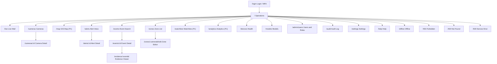
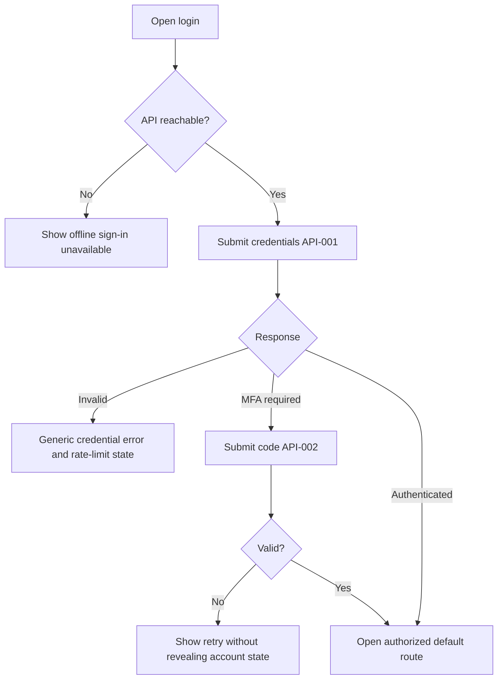

# FALCON Web Flow & UI Specification

**Version:** 1.0  
**Status:** Implementation specification aligned to PRD v1.0 and TRD v1.0  
**Audience:** Product, frontend, backend, QA, operations, security, and accessibility teams  
**Scope:** Browser-based, edge-hosted FALCON operator dashboard. This specification describes the web experience and its contracts; it does not authorize operational use of automated identity matches.

## Source-of-truth rules

1. `docs/PRD.md` defines product priorities, UI, role and workflow requirements.
2. `docs/TRD.md` defines technical names, routes, message envelopes, versions, and service boundaries. Where the TRD says it resolves a conflict, it prevails and the conflict is recorded in `docs/guide/00-conflicts.md`.
3. This document maps those requirements to web behavior. It does not claim that a proposed endpoint or payload exists unless listed in the PRD/TRD.
4. An item without a backend contract is explicitly marked as a **backend gap**, with the UI behavior blocked or read-only until that contract is approved.
5. IDs in this document are stable references: screen `SCR-nn`, flow `FLW-nn`, component `CMP-nn`, action `ACT-nn`, state `STA-nn`, message `MSG-nn`, real-time behavior `RT-nn`, and test `WQA-nn`. Each item cites related PRD/TRD IDs where applicable.
6. Visual identity, theme values, component anatomy and page composition are specified in `docs/design/README.md` and its linked design documents; this file remains authoritative for behavior and backend gaps.

## PART 1 — Overview, Principles & Conventions

### 1.1 Purpose and audience

The dashboard gives authorized personnel a local, edge-served view of camera availability, detected events, alerts, evidence, and node health. It must remain useful when HQ connectivity is absent. Operators verify alerts and make human decisions; FALCON does not autonomously initiate enforcement or force.

### 1.2 Scope and release boundaries

| Capability | PRD priority | Web treatment |
|---|---:|---|
| Login/MFA, live wall, cameras, alerts, evidence, zones, health | P0 | Core MVP workflow |
| Event search, integrity verification, audit, user/role administration | P0 API scope | Show only where authorized APIs and roles are configured |
| GIS, English/Hindi, analytics, watchlists, ANPR, FRS, night/thermal, advanced behavior | P1 or later | Feature-gated; display unavailable state if not deployed |
| Re-identification, pose/action, UAV head, external ledger anchoring | P2 or later | Not part of MVP; do not imply active capability |

### 1.3 Control-room UX principles

1. Alert-first ordering without hiding camera or system health.
2. Acknowledge, review and escalate should be reachable in the PRD limit of four primary clicks (UI-003).
3. New alerts do not steal keyboard focus or move a list while the operator is interacting.
4. High-consequence actions require explicit confirmation and authorization; false-positive feedback requires a reason.
5. Use text, icon, shape and color for severity; color is never the sole meaning.
6. Preserve local operations and clearly label stale, queued or unavailable data; never present a failed operation as successful.
7. Identity-related results are candidates only, require authorized human review, purpose-bound access and audit. No match is a sole basis for action (FR-025–026, NG-02–04).
8. Do not display raw camera credentials, access tokens, private keys or unneeded biometric data.

### 1.4 Browser and screen support

The PRD/TRD do not declare a browser support matrix. Recommended implementation target (assumption A-WEB-01): current stable Chromium-based Edge and Chrome on Windows 10/11, tested with keyboard-only interaction. Support 1920×1080 control-room desktop and 1366×768 laptop; tablet and mobile use a responsive alert-review layout. Wall display is read-only and does not auto-trigger operational actions. Browser support must be verified before field deployment.

| Viewport | Layout rule |
|---|---|
| Wall display / wide desktop | Live wall and alert summary can be shown together; dense data uses labeled, high-contrast text. |
| Desktop / laptop | Persistent navigation, top status bar, route content, optional right-side details panel. |
| Tablet | Collapsible navigation; preserve alert list/detail and evidence review. |
| Mobile web | No multi-camera wall requirement; provide status, alert review, acknowledge, search and evidence metadata. PTZ is hidden unless explicitly supported. |

### 1.5 Design tokens

Severity values are exactly `info`, `low`, `medium`, `high`, `critical` (FR-070). Theme color values are implementation choices, not PRD contracts.

| Token | Recommended value | Non-color cue |
|---|---|---|
| `severity.info` | `#2D6CDF` | Info icon + “Info” |
| `severity.low` | `#237A57` | Low label + circle |
| `severity.medium` | `#A66A00` | Medium label + triangle |
| `severity.high` | `#B54708` | High label + double mark |
| `severity.critical` | `#B42318` | Critical label + octagon |
| `surface.controlRoom` | `#101820` | Dark neutral background |
| `text.primary` | `#F5F7FA` on dark | Minimum 4.5:1 contrast |
| Spacing | 4 px base scale | 4, 8, 12, 16, 24, 32 px |
| Type | System sans-serif; tabular numerals for time/counters | Do not encode state by font alone |

Provide default dark operations theme, light theme for general use, and high-contrast theme. Respect reduced-motion. Keep status text visible when theme changes. Icons must have accessible names.

### 1.6 Global layout and glossary

```text
+--------------------------------------------------------------------------------+
| Site / Local time / Clock status | Node + WS status | Severity counts | User  |
+---------------+----------------------------------------------------------------+
| Navigation    | Global warning or offline banner                              |
| Live Wall     +---------------------------------------------------------------+
| Alerts        | Page title / breadcrumb / primary action                       |
| Map           |                                                               |
| Events        | Page content                                      | Details     |
| Evidence      |                                                               |
| Zones         +---------------------------------------------------------------+
| Admin         | Connection / sync / storage status                              |
+---------------+---------------------------------------------------------------+
| Notification tray (collapsible; alert history and unread counts)              |
+--------------------------------------------------------------------------------+
```

| Term | Meaning |
|---|---|
| Edge node | Site-local computer running FALCON services |
| Alert | Actionable notification with severity, state and associated event |
| Event | Detected or configured occurrence, possibly without an alert |
| Evidence | Snapshot, clip and manifest associated with an event |
| Integrity state | Result of verification: `verified`, `tampered`, `cannot_verify`, or `pending` where backend provides it |
| Zone | Versioned camera-relative line or polygon |
| Stale | Data is older than its freshness threshold or no longer receiving updates |

### 1.7 ID scheme

IDs are unique within each prefix and are referenced in Parts 14 and the traceability table. PRD and TRD requirement IDs retain their original spelling. Gaps use `GAP-nn`, assumptions use `A-WEB-nn`.

## PART 2 — Sitemap, Navigation & Role Access

### 2.1 Sitemap

The sitemap includes routes required by PRD UI and the MVP guide. Watchlist and analytics routes remain feature-gated. Route strings are frontend proposals; PRD/TRD do not define browser URLs.



### 2.2 Route inventory and visibility

Role names follow PRD Section 7.3: Operator, Supervisor, Analyst, Admin, ML Maintainer, Auditor. Command HQ Viewer is a PRD persona but not an explicit RBAC column; see GAP-01. The route guard must use backend authorization, not a client-only role check.

| Screen / route | Title | Intended roles | Requirements |
|---|---|---|---|
| `SCR-01 /login` | Sign in | All | UI-001, SEC-002 |
| `SCR-02 /` | Operations overview | Operator, Supervisor, Analyst, Admin, ML Maintainer, Auditor | UI-002, FR-077 |
| `SCR-03 /live` | Live Wall | All roles with camera view permission | UI-002, FR-010, FR-077 |
| `SCR-04 /cameras` | Cameras | Operator read; Supervisor read; Analyst limited read; Admin manage; ML Maintainer read; Auditor read-only audit | FR-001–008 |
| `SCR-05 /cameras/:id` | Camera Detail | Camera read roles | FR-005–008 |
| `SCR-06 /alerts` | Alert Inbox | Operator, Supervisor; other roles read only when granted | FR-070–078, UI-003 |
| `SCR-07 /alerts/:id` | Alert Detail | Same as alert inbox; permitted actions vary | FR-074–075, FR-080–085 |
| `SCR-08 /map` | GIS Map | Authorized camera/alert viewers | FR-094; P1 |
| `SCR-09 /events` | Event Search | Operator/supervisor as permitted; Analyst purpose-authorized; Auditor read-only audit | FR-082, API-011 |
| `SCR-10 /events/:id` | Event Detail | Event-view permission | API-012 |
| `SCR-11 /evidence/:eventId` | Evidence Viewer | Event-view permission, purpose prompt for sensitive evidence | API-019–022, UI-004 |
| `SCR-12 /zones` | Zones | Read roles; Admin edit; Supervisor request | FR-040–046, UI-005 |
| `SCR-13 /zones/:cameraId/edit` | Zone Editor | Admin edit; Supervisor request | FR-040–046, UI-005 |
| `SCR-14 /watchlists` | Watchlists | Authorized role and purpose only; Supervisor approval for face enrollment | FR-024–026, API-016–018 |
| `SCR-15 /analytics` | Analytics | Authorized viewers | FR-094, API-029–030 |
| `SCR-16 /devices` | System Health | Admin; read-only view permitted to operational roles per deployment | API-008, API-025 |
| `SCR-17 /models` | Models | ML Maintainer, authorized Admin; Auditor read-only | FR-090–093, API-023–024 |
| `SCR-18 /admin/users` | Users and Roles | Admin; Auditor read-only audit | API-026–027, SEC-002–003 |
| `SCR-19 /audit` | Audit Log | Auditor full; Supervisor own shift; Admin/Analyst/ML scoped as PRD | API-028, SEC-003 |
| `SCR-20 /settings` | Settings | Each user for profile; Admin for site configuration | UI-006, FR-084 |
| `SCR-21 /help` | Help & About | All authenticated users | usability |
| `SCR-22 /403` | Access denied | All | SEC-003 |
| `SCR-23 /404` | Not found | All | usability |
| `SCR-24 /500` | Service error | All | API errors |
| `SCR-25 /offline` | Offline status | All authenticated users | NFR-006–008 |

### 2.3 Navigation and deep links

- Primary navigation: Operations, Live Wall, Cameras, Alerts, Map, Events, Zones. Admin group: Devices, Models, Users and Roles, Audit, Settings. Hide unavailable feature routes, but preserve a disabled feature notice only when deployment explicitly enables a planned feature.
- Breadcrumbs reflect route hierarchy and do not imply authorization.
- Alert/event/evidence deep links use opaque IDs, e.g. `/alerts/{id}`. IDs are not credentials; each route reload fetches data and re-checks authorization (FR-085).
- Browser back/forward restores route and filters, not stale mutation state. Unsaved Zone Editor changes trigger the UI-005 save/discard confirmation.
- A `403` shows `MSG-03` and a request ID where available; do not reveal whether a restricted resource exists. A `404` handles unknown routes/resources. `500` offers retry and request ID. Offline page remains locally available and lists last update time.

### 2.4 Role × action matrix

`R` read, `C` create, `E` edit, `D` disable/delete subject to policy, `X` export, `A` acknowledge/resolve, `S` assign/escalate, `V` verify evidence, `P` approve. `—` denied. Backend remains authoritative.

| Role | Live/camera read | Alert A | Alert S | Zone edit | Watchlist | Evidence X/V | Models | Users/roles | Audit |
|---|---:|---:|---:|---:|---|---|---|---|---|
| Operator | R | A permitted alerts | — | — | Limited, purpose-bound search | V where allowed; X policy-gated | — | — | Own actions only |
| Supervisor | R | A | S | Request only | Approve face enrollment; limited search | V/X policy-gated | — | — | Own shift |
| Analyst | Limited R | — | — | — | Create/search if authorized and purpose-bound | X for approved investigation | — | — | Investigation scope |
| Admin | R | Read/configure | S | E | Manage per policy; approval controls remain | V/X | Limited promotion controls | C/E/deactivate | Scoped read |
| ML Maintainer | R | — | — | — | Limited view; no face search | — | Request/promote tested model per policy | — | Own model actions |
| Auditor | Audit-oriented R | — | — | — | Read audit only | V; export per policy | Read | Read audit | Full |

PRD notes operator alert resolution; supervisor may resolve all. Admin does not receive alert action rights by default unless the backend grants them. Dual control and exact export permissions are deployment policy decisions, not assumed UI privileges.

## PART 3 — Global Behaviours

### 3.1 Top bar and global status

| Component | Behavior / state | User action |
|---|---|---|
| `CMP-01` Site selector | Show current `site_id` and site name. Selection reloads scope only after authorization; if multi-site API is absent, show one configured site. | `ACT-01` Select an authorized site; preserve filters only when site scope remains valid. |
| `CMP-02` Clock | Display site-local time and timezone; store/API timestamps remain UTC. Clock drift warning requires a health signal. | No correction controls. |
| `CMP-03` System health | Overall state from `/health/nodes` or WebSocket `node.health`; show last update time and stale label. | Open Devices. |
| `CMP-04` Severity counters | Counts by exact severity; clicking applies inbox filter. | `ACT-02` Open filtered Alerts. |
| `CMP-05` User menu | Name, role, MFA/session status if available, Settings, Sign out. | `ACT-03` Sign out clears client state. |
| `CMP-06` Language/theme | English default; Hindi P1. Changing locale/theme does not clear form or query state (NFR-010). | `ACT-04` Switch locale/theme. |
| `CMP-07` Help | Opens route and keyboard shortcut list. | `ACT-05` Open Help. |

Global banners are independently visible and dismissible only if they are informational; critical integrity/security/offline conditions remain until cleared. `STA-01` API down, `STA-02` WebSocket disconnected, `STA-03` HQ sync pending, `STA-04` node offline, `STA-05` storage warning/safe mode, `STA-06` maintenance, `STA-07` clock drift, `STA-08` model update. The API does not currently define licence, clock-drift or maintenance message fields; do not invent values (GAP-02).

### 3.2 Notification behavior

`CMP-08` notification tray groups duplicate alert updates by alert ID, retains a bounded local history, and marks unread state. Alert sound is enabled only after a user gesture and explicit preference. Browser notification permission is requested in context, never on initial page load. Critical notifications are not muted by DND; sound may be muted, but visual alert display cannot be disabled. Grouping and suppression must not discard new distinct critical alerts. Sound preferences and delivery counters lack API contracts (GAP-03).

| State | Visible text/action |
|---|---|
| `STA-09` New notification | Severity, title, camera, site-local time, Open alert |
| `STA-10` Duplicate update | Update existing item; increment update count and retain newest state |
| `STA-11` Browser permission blocked | Inform user; tray remains functional |
| `STA-12` Sound autoplay blocked | “Sound is unavailable until you interact with this page.” |
| `STA-13` Notification history empty | “No notifications yet.” |

### 3.3 Session and security

Access tokens expire after 15 minutes; refresh policy is 24 hours (TR-SEC-001 and PRD 7.1). Privileged roles require MFA. The dashboard must not store bearer or refresh tokens in local storage; use secure, HttpOnly cookie where the backend supports it, otherwise document an approved secure alternative before release (GAP-04). Sensitive evidence access requires authorization recheck. Session expiry suspends mutations and offers sign-in; alert display remains active only if the authenticated service permits it. Auto-lock duration, session concurrency and logout-everywhere APIs are unspecified (GAP-05); no client-side impersonation or false security claim.

### 3.4 Search, keyboard and accessibility

`CMP-09` global search opens with `/`, supports cameras, events and alerts with server authorization. Plate/face search requires explicit purpose and is feature/role gated. Shortcut precedence avoids activating while focus is in editable fields.

| Shortcut | Action | Related |
|---|---|---|
| `/` | Focus global search | PRD UI/UX 8.4 |
| `A` | Acknowledge selected alert after permission check | UI-003 |
| `E` | Open escalation action for selected alert | UI-003 |
| `F` | Open false-positive dialog; reason required | FR-075 |
| `C` | Open close/resolve dialog | FR-074 |
| `?` | Show shortcut help overlay | PRD UI/UX 8.4 |
| `Esc` | Close topmost dialog, then clear selection | Standard |
| `Enter` | Activate focused control | WCAG 2.1 AA |

`STA-14` focus indicators are always visible; status updates are announced through a polite ARIA live region and critical alerts through assertive region without repeatedly announcing unchanged cards. Target WCAG 2.1 AA, text contrast at least 4.5:1, keyboard order, reduced motion, labels for controls, captions/transcripts for instructional media, and no color-only meaning.

### 3.5 Common data and responsive states

Every data panel implements `STA-15` loading, `STA-16` empty, `STA-17` error/retry, `STA-18` offline/cached with timestamp, `STA-19` permission denied, and `STA-20` partial data. Video adds live, buffering, reconnecting, offline, no signal, and unavailable stream states. Charts identify missing intervals and do not render missing values as zero. API errors use TRD JSON error shape and HTTP codes 401/403/404/409/422/429/503.

### 3.6 Formats and localization

Use UTC over APIs and render site-local time with timezone abbreviation. Display confidence as percentage with documented precision, distances in meters, speed in m/s unless site config specifies another unit, and storage in GiB. English is baseline; Hindi is P1. IDs, severity enum and machine statuses never translate. Translation fallback is English; long Hindi labels wrap, controls do not clip, and switching locale preserves current route, form values and selection.

## PART 4 — Authentication & First-Run Flows

### 4.1 Authentication screens

`SCR-01` includes username, password, Sign in, locale selector, and an inline offline/service status. Privileged users receive MFA challenge after valid credentials. PRD lists `/auth/login` and `/auth/mfa/verify`; password reset, lockout policy, first-run setup and self-service enrollment have no API contract.

| Field | Validation | Error |
|---|---|---|
| Username | Required; exact backend accepted identifier format | `MSG-01` “Enter your username.” |
| Password | Required; do not trim or log | `MSG-02` “Enter your password.” |
| MFA code | Required when challenged; server validates | “The code could not be verified. Try again or contact your administrator.” |

### 4.2 Login flow



No client-invented retry count or lockout duration. Honor 429 and server error text safely. Do not reveal whether a username exists. Session expiry/forced logout displays the reason when supplied and returns to login after clearing cached protected data.

### 4.3 First-run setup

No setup wizard endpoints or camera credential provisioning contract are present. Do not implement setup as if it were functional. GAP-06 lists required endpoints. For MVP, operations/admin provisioning happens through approved backend/deployment procedure; login screen clearly reports that setup is not yet available if no admin exists. A future wizard should have explicit steps: create admin, site/timezone, time-sync check, camera onboarding, zone creation, test event, users, backup. No stored camera password may be rendered in clear text (FR-003, SEC-004).

### 4.4 Password, timeout and forced logout

Password expiry/change, recovery, session list and forced logout endpoints are absent. The UI shows an administrator-contact path rather than fake forms. For API 401, preserve no sensitive form content, display session-expired text and require reauthentication for subsequent actions. Never hide active alert banners solely because the user is idle.

## PART 5 — Live Operations Screens

Shared screen requirements: each screen uses global states `STA-15`–`STA-20`; all mutation actions require backend authorization, idempotency key and visible result; streams/events have an explicit last-update timestamp; screen route changes preserve only safe UI state. API names below use `/api/v1` prefix.

### 5.1 SCR-02 Operations Overview

Purpose: show alert priority, camera coverage and node condition at a glance. Wireframe:

```text
+-------------------+----------------------+----------------------+
| Severity counts   | Active alerts        | Edge/node health     |
+-------------------+----------------------+----------------------+
| Map / site status | Recent alert feed    | Camera activity     |
+-------------------+----------------------+----------------------+
| Shift summary (requires handover API; otherwise omitted)          |
+-------------------------------------------------------------------+
```

Components: `CMP-10` severity counters; `CMP-11` recent alert list; `CMP-12` camera status summary; `CMP-13` map snapshot (P1); `CMP-14` node health tiles. Actions: `ACT-06` open alert; `ACT-07` filter by severity; `ACT-08` open camera; `ACT-09` open health. Data from API-014, API-025, WebSocket alert/camera/node messages. Refresh on push; REST resync after connection gaps. Shift summary endpoint absent (GAP-07). Acceptance: critical and stale conditions remain visible; only authorized site data is displayed.

### 5.2 SCR-03 Live Wall

```text
+--------------------------- Live Wall ----------------------------------+
| [1][4][9][16] [Saved layout] [Low bandwidth] [Overlay layers]          |
| +-------------------+ +-------------------+                              |
| | Camera / status   | | Camera / status   |   Selected camera controls   |
| | Video + overlays  | | Video + overlays  |   Snapshot / flag / PTZ*    |
| +-------------------+ +-------------------+                              |
+-------------------------------------------------------------------------+
```

`CMP-15` grid; `CMP-16` camera tile; `CMP-17` overlay; `CMP-18` stream status; `CMP-19` tile actions. Layout sizes 1/4/9/16 are local UI options; custom layouts and saved/shared presets require persistence APIs (GAP-08). In MVP, show HLS via MediaMTX if available; PRD/TRD do not provide a dashboard stream URL API. Do not use a raw RTSP URL in browser or expose camera credentials.

Actions: `ACT-10` choose grid; `ACT-11` choose camera; `ACT-12` toggle available detection/track/zone overlays; `ACT-13` open full-screen; `ACT-14` take snapshot (requires evidence API/gap); `ACT-15` flag moment (API contract absent); `ACT-16` switch stream quality (gap); `ACT-17` PTZ move/stop (API-007, P1); `ACT-18` return from alert focus. Audio muted by default. PRD UI-002 requires 16 selected tiles to update with no more than 2-second UI delay; TRD performance contract does not guarantee 16 streams, so display resource/stream limitations rather than claim them. Alert auto-focus must be opt-in with clear pause/return control; auto-focus behavior is an assumption A-WEB-02.

Tile states: live, buffering, reconnecting, offline, no-signal, privacy-masked only when backend explicitly indicates mask, and night/IR indicator only when metadata is supplied. Overlay payload in TRD exists for detections/tracks but dashboard delivery channel/frequency is unspecified (GAP-09); avoid fabricating live overlay updates. Tests: WQA-01, WQA-02.

### 5.3 SCR-04/05 Cameras and Camera Detail

Camera list columns: name, site, group, protocol, connection state, last frame, analytics state, stream profile, and actions allowed. Credentials always masked. Camera detail includes video if a safe stream endpoint exists, health, recent related alerts/events, zones, and settings link. Data: API-003/004/006/008; camera status and node health WebSocket messages.

Actions: `ACT-19` open camera; `ACT-20` add camera (API-003); `ACT-21` discover ONVIF (API-005); `ACT-22` test connection (API-006); `ACT-23` edit/disable (API-004); `ACT-24` PTZ move/stop (API-007, P1). Delete confirmation must name impact and use API disable semantics if deletion is not supported. Discovery 30-second limit and manual stream connection 10-second target follow FR-001/002. Camera network scanning is limited to an explicitly authorized local administrative workflow. There is no API for stream playback URL, camera groups, site map position or analytics configuration (GAP-10).

### 5.4 SCR-06/07 Alert Inbox and Detail

```text
+-------------------------------+-------------------------------------------+
| Filters: severity/type/site   | Alert title / severity / state / age      |
| camera/time/status/assignee   | Explanation / camera / evidence status    |
| [saved filter]*               | Snapshot / clip link / action timeline    |
| Alert rows + SLA/updated time | [Ack] [Assign] [Escalate] [Resolve]       |
+-------------------------------+-------------------------------------------+
```

List fields: title, severity, state, camera, category, created time, assigned user if present, evidence availability and unread marker. New records insert without moving current selection; show “N new alerts” pill. Filter query uses API-014 with parameters supported by backend only. Detailed event explanation uses API-012 and includes rule/track/zone context where present.

Actions: `ACT-25` acknowledge, `ACT-26` assign, `ACT-27` escalate, `ACT-28` resolve true positive, `ACT-29` mark false positive with mandatory reason, `ACT-30` close, `ACT-31` open evidence, `ACT-32` copy authorized deep link, `ACT-33` open map if geo data exists. All mutations POST `/api/v1/alerts/{id}/actions` (API-015) with an action enum confirmed by backend, idempotency key and expected current state. On 409, refresh and explain conflict; never overwrite another operator action. PRD state machine includes `new -> acknowledged -> escalated -> resolved -> closed` and `new -> false_positive -> closed`; do not render a different lifecycle. The web cannot claim soft locks, assignment/SLA timers, comments or duplicate merge metadata without backend fields (GAP-11).

False-positive reason choices require backend approved list; until then require non-empty free text and save the exact reason, not invented categories. Confirmation text is `MSG-04`. Evidence links expire within 15 minutes and authorization is rechecked (FR-085). WQA-03 through WQA-06.

### 5.5 SCR-08 Map / GIS

P1 route. Display offline tiles only if locally deployed and legally approved; no internet tile fallback. Markers distinguish camera status and alert severity by icon+label. Map/list selection is synchronized. API-030 returns heatmap aggregates; site/camera coordinates, map tile service, FOV geometry, route service and time replay API are absent (GAP-12). If tiles are unavailable, show coordinates/list view and missing-tile notice rather than blank map.

Actions `ACT-34` layer toggle; `ACT-35` select marker; `ACT-36` open alert/camera; `ACT-37` select time range. No measure/response routing until a supported map contract exists.

### 5.6 SCR-09/10 Event Search and Detail

Search filters supported by FR-082: camera, time, class, plate, zone, severity, status. Additional person ID, free text, behavior type need API extensions. Results are paginated (default 50, max 200) and query duration is visible; API-011 and API-012. `ACT-38` submit search; `ACT-39` clear filters; `ACT-40` open event; `ACT-41` save search is unavailable until persistence API (GAP-13); `ACT-42` export is API-022 only where authorized and P1.

No search results is a distinct empty state. A slow query does not imply failure; show elapsed time and allow cancel only if backend supports cancellation. Use safe text rendering for OCR and event content. WQA-07.

### 5.7 SCR-11 Evidence Viewer

Show snapshot, clip player where supported, UTC capture time and local display, event metadata, manifest, and integrity state. Evidence download uses expiring links API-019/020; verify uses API-021; export uses API-022. `ACT-43` request snapshot, `ACT-44` request clip, `ACT-45` verify now, `ACT-46` export package. A required sensitive-evidence access-purpose prompt is not specified for general evidence; apply it to plate/face searches and any policy-designated evidence route. Frame stepping, brightness/contrast, chain-of-custody UI and PDF report are not defined by backend (GAP-14).

Integrity outcomes: verified only on successful verifier response; tampered is a blocking red state and never “verified”; cannot verify is distinct from tampered; pending anchor is not equivalent to pending local verification. Preserve `entry_hash`, `prev_hash`, signature and `anchor_status` returned by ledger contract. WQA-08.

## PART 6 — Analytics-Specific Screens

Feature routes are P1+ and must remain disabled unless API and governance are configured.

### 6.1 ANPR and plate search

FR-030–035, API-016. Display normalized OCR text, character confidence and candidate status only when returned by server. Require explicit purpose for plate search and audit every search. `ACT-47` submit plate search; `ACT-48` correct OCR is not available in the API contract and must not silently mutate data (GAP-15). Watchlist manager CRUD/import/approval/expiry is not covered by the listed API except plate search; do not implement enrollment without endpoint contract. P1 candidate matches require operator verification, never autonomous action.

### 6.2 Face recognition

FR-020–026, API-017/018. Face feature requires legal/privacy approval, at least two consented or legally authorized images for enrollment, supervisor approval, expiry, calibrated threshold, mandatory purpose/audit, human confirmation and no automatic enforcement. `ACT-49` request candidate search; `ACT-50` confirm/reject/unsure must be human-reviewed and auditable, but the result endpoint is missing (GAP-16). Do not expose raw embeddings. If governance flag or audit service is unavailable, disable search and enrollment. UI presents model limitations and candidate similarity without implying identity certainty.

### 6.3 Virtual Fence / Zone Editor

FR-040–046, APIs-009/010. Display frozen camera frame, normalized line/polygon geometry, version and schedule/direction where fields exist. Actions: `ACT-51` draw/edit vertices; `ACT-52` undo; `ACT-53` redo; `ACT-54` save draft; `ACT-55` activate version; `ACT-56` discard changes; `ACT-57` request test mode. Geometry validation rejects points outside normalized range and invalid geometry; exact self-intersection validation applies to polygons. PRD requires save/discard prompt (UI-005). Version history, rollback, test clip simulation, approval workflow and calibration fields have no explicit endpoints (GAP-17). Activation sends API-010 only after API-009 creates the version; retain the current version on failure.

### 6.4 Behavior, night and thermal

FR-050–063. Read-only behavior event details may appear when returned in event explanation; configuration controls are disabled until backend rules/config APIs exist. Night/IR indicator is metadata-driven; manual override and schedule require a missing API (GAP-18). Do not represent an optical feed as thermal. Degraded scene confidence must be visible if the event payload includes it.

### 6.5 Analytics and reports

FR-094, API-029/030. Show alerts over selected supported date range, false-positive rate, median latency and heatmap only from returned aggregates. Compare periods, scheduled reports, CSV/PDF, shift report and camera uptime breakdown require additional fields/endpoints (GAP-19). Provide range, timezone and sample count. Suppress values when no data; never use zero to mean unavailable.

## PART 7 — Administration & Configuration Screens

### 7.1 Cameras and sites

Onboarding follows API-005 discovery, API-003 create, API-006 test, API-004 read/update/disable, API-008 health. Wizard steps: discover or manual entry; enter credentials securely; test; review returned stream details; assign site/location only if field exists; confirm; finish. Do not keep credentials in browser state after submission. Site selector, location assignment and bulk import are backend gaps GAP-10.

### 7.2 Models

API-023/024, FR-090–093. List model name/version/license/dataset hash/test report/signature/status when supplied. Promotion is role-restricted and must require server signature verification and tests. UI may request promotion; do not show active until confirmed. Upload/staging/rollback/progress/SBOM endpoint is missing (GAP-20). Feedback dataset view may use FR-093 summary only if API supplies it.

### 7.3 Alert rules and integrations

Alert lifecycle and API-014/015 are supported. Rule editor, escalation timers, channel management, webhook secret rotation, siren/relay, delivery test and retries are not exposed as UI APIs (GAP-21). Do not present an action as sent until confirmed. Siren/relay must remain absent from P0 UI; future use requires role, approval policy and signed audit action (FR-076).

### 7.4 Users, roles and audit

API-026/027 users/roles; API-028 audit. User create/update/deactivate routes need contract details on supported methods/fields. UI must show role, active state and MFA status only if returned. Force logout, password policy, MFA reset and shift roster APIs are gaps GAP-05/22. Audit filters use supported actor/purpose/resource filters. Never render raw secrets from logs.

### 7.5 Device health, integrations, backup and settings

API-025 nodes and API-008 camera health support read views. CPU/GPU/RAM/disk/temperature fields are only shown if present. Diagnostic bundle, restart service, integrations, backups/restores, legal hold, retention mutation, ledger key management and site settings require endpoints and stronger confirmation (GAP-23). No restart/deletion controls are exposed until those are specified and audited.

## PART 8 — End-to-End Flows

Each flow lists the web-visible sequence; backend implementation and outcome must be confirmed by API response/event. Failures never create a success-shaped UI state.

| Flow ID | Trigger / actors | Main steps and screens | Alternate/failure handling | Evidence / acceptance |
|---|---|---|---|---|
| `FLW-01` Shift start | Operator | SCR-01 login/MFA → SCR-02 → SCR-03 Live Wall → SCR-06 review active alerts | Handover notes/count API missing; show no fabricated notes. API down keeps login blocked and reports offline. | Session and alert actions audit; camera and alert status are current. FR-078, UI-001/002 |
| `FLW-02` Alert while watching | Operator | WebSocket `alert.created` → banner/tray → SCR-07 → verify evidence → acknowledge/escalate/resolve | If WS disconnects, show stale and REST resync; do not steal focus. | One alert ID remains one record; action result visible. FR-071/073–077 |
| `FLW-03` Alert on another route | Operator | Global alert banner → open alert deep link → SCR-07 | If route is unauthorized, 403 without resource disclosure; preserve current route. | Alert remains actionable and deep link rechecks authorization. |
| `FLW-04` Night event | Operator | Camera metadata indicates night/IR → SCR-05/07 review event and degradation metadata | No metadata means “mode unknown”; do not infer thermal mode. Manual override is unavailable until API exists. | FR-060–063, WQA-11 |
| `FLW-05` Escalate and close | Operator, Supervisor | SCR-07 acknowledge → assign/escalate → supervisor review → resolve/close | 409 refreshes state; missing role returns 403; siren is not available in MVP UI. | `alert_actions`/audit record; UI-003 <=4 primary clicks. |
| `FLW-06` False positive feedback | Operator | SCR-07 false-positive dialog → enter required reason → submit API-015/API-013 as defined by backend | Empty reason blocked; conflict reloads current state. | FR-075, FR-093; label and context are audited. |
| `FLW-07` Plate candidate | Authorized operator/analyst | SCR-14 purpose prompt → API-016 search or candidate alert → human review | API/audit unavailable disables search; no automatic enforcement. OCR correction blocked until API is added. | Purpose and search audit; FR-032/035 |
| `FLW-08` Face candidate | Authorized operator/supervisor | Authorized candidate event → purpose/context → human confirm/reject/unsure | No legal approval, audit, expiry or decision API means feature disabled. | `human_confirmed=false` until authorized review; FR-024–026 |
| `FLW-09` Zone crossing | Operator | SCR-13 inspect version → SCR-07 explanation shows zone version, track and direction | Missing payload field shown as unavailable; no fabricated geometry. | FR-040–046; event references version. |
| `FLW-10` Alert storm | Operator/Supervisor | WS updates → group by alert ID/state, show counts and bounded list; filter critical/high | Never drop distinct critical alerts; if event replay exceeds capacity, indicate count and fetch REST page. | Dedup by event/alert ID and sequence; WQA-12 |
| `FLW-11` Camera failure/recovery | Operator/Admin | WebSocket camera.status → SCR-04/05 degraded/offline → recovery after backend state update | Stale timestamp remains visible; do not claim recovered until status says so. | FR-005/006, API-008 |
| `FLW-12` HQ connectivity lost | Operator | `sync.pending` or node status → offline banner → local operations continue | Conflict resolution policy/server data absent; show queued state and avoid claiming sync complete. | NFR-006/007; GAP-24 |
| `FLW-13` API/WS drops mid-action | Operator | Mutation pending → timeout/offline indication → query status/refresh before retry | Retry only with same idempotency key; on unknown result do not submit a new action blindly. | RFC 7807, 409/503; WQA-13 |
| `FLW-14` Add camera and zone | Admin | SCR-04 discovery/manual → test → save → SCR-13 draw → activate | Any test/save failure preserves prior state; credential never redisplayed. | FR-001–003/040, API-003/005/006/009/010 |
| `FLW-15` Edit zone | Admin | Load current version → edit → save new version → activate | UI-005 confirms discard; activation conflict reloads; rollback endpoint missing. | FR-046; version audit, GAP-17 |
| `FLW-16` Export/verify evidence | Analyst/Auditor | SCR-11 request export → manifest → auditor API-021 verification | Expired link fetched again; tamper response red and blocked; cannot verify shown distinctly. | API-019–022, NFR-016, UI-004 |
| `FLW-17` Shift handover | Operator/Supervisor | SCR-02 alert counts → review unresolved alerts → report | Handover notes/report API absent; show counts only if data available. | FR-078, GAP-07 |
| `FLW-18` Model update/rollback | ML Maintainer/Admin | SCR-17 inspect model → request promotion API-024 | Upload/stage/rollback absent; no “active” state until backend confirms. | FR-090/091, SEC-005; GAP-20 |
| `FLW-19` User administration | Admin | SCR-18 create/update user and role → verify result | Lockout recovery, reset MFA and force logout absent; route to approved admin process. | API-026/027, SEC-003 |
| `FLW-20` Storage pressure | Operator/Admin | `node.health`/API-025 reports threshold → persistent warning → inspect health | At 10% headroom warn, at 5% safe mode; retention action unavailable and evidence loss never hidden. | NFR-008, GAP-23 |
| `FLW-21` Session expires during critical alert | Operator | Alert stays visible if permitted; mutation receives 401 → sign-in → reload alert → act | Do not replay a mutation without checking state; no action is claimed before server response. | TR-SEC-001, WQA-14 |
| `FLW-22` Clock drift | Operator/Admin | Health signal indicates drift → warning with source/time | No drift fields/API: do not estimate from browser clock alone; GAP-02. | UTC timestamps retained; GAP-02 |
| `FLW-23` Restart or power loss | Operator/Admin | Node health unavailable → status banner → service returns → REST resync and last-seen timestamps | Preserve queue; if evidence incomplete show failure reason; no assumed recovery success. | NFR-013/014, OPS-003, WQA-15 |

## PART 9 — Real-Time Behavior Specification

### 9.1 WebSocket connection lifecycle

TRD contract: authenticated channel `/ws/v1/operator`; short-lived token; subscribe to `alert.created`, `alert.updated`, `camera.status`, `node.health`, `sync.pending`; envelope `{channel, resource_id, sequence, event, data, occurred_at}`. Resynchronize via REST after sequence gap or 30-second heartbeat timeout.

`RT-01` Connect after authenticated shell load. `RT-02` Subscribe only to authorized scope. `RT-03` On disconnect show reconnecting state and last event time. Backoff base/cap/jitter are not specified by TRD; use a bounded exponential policy as a frontend implementation choice and report exact chosen values in code/config, without treating them as server contract. `RT-04` On sequence gap or heartbeat timeout fetch relevant REST state before resuming live updates. `RT-05` discard duplicate sequence/event IDs and preserve monotonic ordering per channel; if ordering cannot be reconciled, mark stale and resync.

### 9.2 Message catalog

Only the envelope and event names below are contractually specified. Example `data` fields are examples based on PRD/TRD entity contracts; optional fields must be guarded. Proposed event names beyond these are gaps.

```json
{
  "channel": "alert.created",
  "resource_id": "event-uuid",
  "sequence": 1042,
  "event": "alert.created",
  "data": {
    "schema_version": "1.0",
    "event_id": "event-uuid",
    "camera_id": "camera-uuid",
    "severity": "high",
    "category": "virtual_fence",
    "title": "Person crossed north line",
    "explanation": {
      "rule_id": "VFR-1",
      "direction": "north",
      "track_id": "cam12:482"
    },
    "created_at": "2026-11-17T10:15:30.700Z",
    "idempotency_key": "edge-node-01:frame:482:VFR-1",
    "evidence": {
      "snapshot_id": "snapshot-uuid",
      "clip_id": "clip-uuid"
    }
  },
  "occurred_at": "2026-11-17T10:15:30.700Z"
}
```

```json
{
  "channel": "camera.status",
  "resource_id": "camera-uuid",
  "sequence": 1043,
  "event": "camera.status",
  "data": {
    "camera_id": "camera-uuid",
    "status": "offline",
    "last_frame_at": "2026-11-17T10:15:20Z",
    "reconnect_count": 3
  },
  "occurred_at": "2026-11-17T10:15:30Z"
}
```

```json
{
  "channel": "node.health",
  "resource_id": "edge-node-01",
  "sequence": 1044,
  "event": "node.health",
  "data": {
    "node_id": "edge-node-01",
    "status": "online",
    "storage_free_percent": 12,
    "updated_at": "2026-11-17T10:15:30Z"
  },
  "occurred_at": "2026-11-17T10:15:30Z"
}
```

```json
{
  "channel": "sync.pending",
  "resource_id": "edge-node-01",
  "sequence": 1045,
  "event": "sync.pending",
  "data": {
    "node_id": "edge-node-01",
    "pending_count": 12,
    "oldest_pending_at": "2026-11-17T09:00:00Z"
  },
  "occurred_at": "2026-11-17T10:15:30Z"
}
```

`alert.updated` uses the alert/event identifiers and updated state returned by the service; no fixed schema is defined in TRD. Detection overlays, model status, ledger status, user presence/locking, heartbeat frame, delivery receipts and operator comments have no WebSocket event contract (GAP-25).

### 9.3 Ordering, buffering and updates

- `RT-06`: keyed updates replace existing records by stable ID; never append duplicate alert cards.
- `RT-07`: while the user scrolls or has a selected alert, newly received records increment a “new alerts” counter; do not reorder the visible list.
- `RT-08`: use sequence numbers to identify gaps. REST is source of truth after any gap or reconnect.
- `RT-09`: never optimistically mark an alert action complete; show pending until API response. On 409/422/403/503 revert pending state and show actionable error.
- `RT-10`: apply bounded in-memory histories and unsubscribe/cleanup on route disposal; long-lived tab soak and 16-tile resource behavior require measurement (TST-003/004).
- `RT-11`: video/overlay timestamp alignment cannot be specified until stream playback and overlay timestamp contracts are published (GAP-09).
- Polling fallback cadence is not defined; do not create aggressive polling. A deployment may configure periodic REST resync; display stale state if unavailable.

### 9.4 Concurrency and offline behavior

Alert actions can conflict. Use API-015 response as authoritative; 409 refreshes event and action history. No soft-lock/lease API exists (GAP-11). Offline local mutation queue, sync conflict resolution and idempotent retry semantics must follow backend implementation; do not queue an action in browser and imply it will execute later. Only retry mutations when the same `Idempotency-Key` and server contract make it safe. Offline banner distinguishes HQ sync loss from local API loss.

## PART 10 — Data & API Mapping

### 10.1 API conventions

Base `/api/v1`, Bearer authentication, `X-Request-ID`, `X-Node-Id` for edge writes, `Idempotency-Key` for mutations, RFC 7807-style JSON errors, pagination default 50/max 200, HTTP status set 200/202/401/403/404/409/422/429/503 (TRD and PRD 6.4). Never log auth tokens, camera credentials, face images/embeddings or raw secret fields.

### 10.2 Screen-to-API matrix

| Screen | APIs | WebSocket events | Notes / missing contract |
|---|---|---|---|
| SCR-01 Login | API-001, API-002 | — | Reset/lockout absent |
| SCR-02 Overview | API-014, API-025 | alert.created/updated, camera.status, node.health, sync.pending | Summary aggregates partly missing |
| SCR-03 Live Wall | API-003, API-008; API-007 P1 | camera.status, node.health | Browser stream URL and overlays missing |
| SCR-04/05 Cameras | API-003–008 | camera.status, node.health | Site/group/stream details partial |
| SCR-06/07 Alerts | API-014/015, API-012/013 | alert.created/updated | Filter/action field schemas incomplete |
| SCR-08 Map | API-030, API-003 | known alert/camera/node events | Coordinates/base tiles missing |
| SCR-09/10 Events | API-011/012 | alert events if applicable | Query fields beyond FR-082 missing |
| SCR-11 Evidence | API-019–022, API-021 | — | Download/verification response detail incomplete |
| SCR-12/13 Zones | API-009/010 | — | Schema, version, schedule details incomplete |
| SCR-14 Watchlists | API-016–018 | — | P1 only; enrollment action/API incomplete |
| SCR-15 Analytics | API-029/030 | — | Date-range and response schemas incomplete |
| SCR-16 Devices | API-008/025 | node.health, camera.status, sync.pending | Metric schema incomplete |
| SCR-17 Models | API-023/024 | — | Upload/stage/rollback absent |
| SCR-18 Users/Roles | API-026/027 | — | Field schemas and lifecycle details incomplete |
| SCR-19 Audit | API-028 | — | Cursor/filter fields incomplete |

### 10.3 Client data models

Use generated OpenAPI types when available. The following are UI-facing minimum types derived from PRD/TRD, not a replacement backend schema. Optional properties must be treated as absent.

```ts
type Severity = "info" | "low" | "medium" | "high" | "critical";
type AlertState =
  | "new"
  | "acknowledged"
  | "escalated"
  | "resolved"
  | "false_positive"
  | "closed";

interface Site { id: string; name: string; timezone?: string }
interface Camera {
  id: string; name: string; site_id?: string; status?: string;
  last_frame_at?: string; protocol?: string; profile?: string;
}
interface Zone {
  id: string; camera_id: string; version?: number;
  type?: "line" | "polygon"; geometry?: { points: number[][] };
}
interface Detection {
  class: string; confidence: number; bbox_xyxy: [number, number, number, number];
  frame_id: string; captured_at: string; model_id: string;
}
interface Track {
  camera_id: string; track_id: string; class: string;
  status: string; ground_point: [number, number]; timestamp: string;
}
interface EvidenceRef { snapshot_id?: string; clip_id?: string }
interface Alert {
  event_id: string; camera_id: string; severity: Severity; category: string;
  title: string; explanation?: Record<string, unknown>; created_at: string;
  idempotency_key?: string; evidence?: EvidenceRef; state?: AlertState;
}
interface Event { id: string; created_at?: string; alert?: Alert }
interface IntegrityRecord {
  evidence_sha256?: string; metadata_sha256?: string; prev_hash?: string;
  entry_hash?: string; ed25519_signature?: string; signer_node_id?: string;
  merkle_root?: string; anchor_status?: string; anchored_at?: string;
  created_at?: string;
}
interface PlateRead { normalized_text?: string; confidence?: number; character_confidence?: number[] }
interface FaceMatch { watchlist_id?: string; similarity?: number; human_confirmed?: boolean }
interface WatchlistEntry { id: string; expires_at?: string; reason?: string; approval_status?: string }
interface User { id: string; username?: string; role?: string; active?: boolean }
interface Role { id: string; name: string; permissions?: string[] }
interface AuditEntry { id: string; actor?: string; action?: string; purpose?: string; occurred_at?: string }
interface HealthMetric { node_id?: string; camera_id?: string; name: string; value: number; observed_at: string }
interface ModelInfo { id: string; name: string; version: string; status?: string; signature?: string }
interface Report { id: string; created_at?: string; format?: "csv" | "pdf" }
```

### 10.4 Error and caching behavior

Cache static locale/theme and non-sensitive layout preferences locally. Do not cache signed evidence URLs beyond their expiry or protected evidence bytes outside approved viewer memory. Cache read-only list pages only with a visible timestamp and access check on re-entry. Never cache mutation success before server response. Render 401 as reauthentication, 403 as denied, 404 as absent/not authorized, 409 as conflict, 422 field validation, 429 rate limit and 503 unavailable.

## PART 11 — Components, State Management & Technical Design

### 11.1 Component inventory

| ID | Component | Props / state | Events |
|---|---|---|---|
| CMP-01 | Site selector | authorized sites, selected site, loading | site change |
| CMP-02 | Site clock | UTC timestamp, timezone, drift status | none |
| CMP-03 | System health indicator | node status, freshness | open health |
| CMP-04 | Severity counters | counts by enum | apply filter |
| CMP-05 | User menu | principal and session state | settings/sign out |
| CMP-06 | Locale/theme controls | locale, theme | preference update |
| CMP-07 | Global status banner | status code, timestamp, severity | retry/open details |
| CMP-08 | Notification tray | notification list, unread count | open/dismiss/mute |
| CMP-09 | Global search | query, result categories | search/open |
| CMP-10–14 | Overview widgets | alert/camera/node/map data | navigation |
| CMP-15–19 | Wall/grid/tile/video/overlay | camera ID, stream state, layer toggles | select/PTZ/flag |
| CMP-20 | Alert list | page, filters, selected ID, new count | select/action |
| CMP-21 | Alert detail | event, actions, evidence | mutation/open evidence |
| CMP-22 | Evidence viewer | URLs, player, metadata, integrity state | verify/export |
| CMP-23 | Zone editor | frame, normalized geometry, dirty state | edit/save/activate |
| CMP-24 | Data table | rows, pagination, sorting, loading | sort/page/select |
| CMP-25 | Confirmation dialog | title, consequence, required input | confirm/cancel |
| CMP-26 | Accessible live region | message and urgency | announce |

### 11.2 Frontend architecture

Recommended implementation in existing repository path `apps/dashboard` (TRD), React 18 + TypeScript. Use route-level lazy loading and shared layout. Server state uses typed query/cache layer; UI state uses route/local state; real-time store deduplicates by ID and sequence. Forms use schema validation generated or aligned with API contracts. Add error boundaries per route; never convert an exception into empty success data.

Folders: `src/app`, `src/routes`, `src/features/{alerts,cameras,evidence,zones,health,events}`, `src/components`, `src/api`, `src/realtime`, `src/i18n`, `src/theme`, `src/test`. Use generated API types from OpenAPI when published; until then hand-maintain minimal contracts from PRD and mark unknown schema fields optional.

### 11.3 Video, map and security

Use the configured MediaMTX HLS/WebRTC endpoint only through an authorized playback URL API or controlled same-origin deployment; avoid embedding RTSP credentials in the client. Render overlays as SVG/canvas only after timestamp and coordinate contract exists. Offline map tiles must be locally hosted; do not send map queries to third-party services. The stream gateway, CSP, CORS, token storage, CSRF and clickjacking headers are deployment/backend requirements; validate before release. Escape all OCR, plate text, titles and external strings; never use unsanitized HTML rendering. Validate upload type/size/signature server-side.

### 11.4 Performance and observability

Respect PRD targets: live list refresh <=2 seconds; event detail P95 <=500ms; search P95 <=2s for 100k rows; low-bandwidth 256kbps loads metadata/snapshots and explicitly defers clips. Do not assert 16 simultaneous video streams on hardware without benchmark. Browser logs include request/event/camera/node correlation IDs but no personal data, tokens, credentials or biometrics. Long-running tabs bound caches, release video tracks, remove listeners and periodically resync via REST.

## PART 12 — Messages, Labels & Microcopy

Exact English copy is specified here. Hindi translation must be supplied and reviewed by native-language product reviewer; no unreviewed translation is presented as final. IDs remain locale independent.

| ID | English | Hindi status | Where |
|---|---|---|---|
| MSG-01 | Enter your username. | Translation required | Login validation |
| MSG-02 | Enter your password. | Translation required | Login validation |
| MSG-03 | You do not have access to this page. Contact your administrator if you need access. | Translation required | 403 |
| MSG-04 | Mark this alert as a false positive? Enter a reason. This decision will be recorded. | Translation required | Alert action |
| MSG-05 | New alerts are available. | Translation required | Inbox new-items pill |
| MSG-06 | Connection lost. Showing the last available data from {time}. | Translation required | Offline/stale banner |
| MSG-07 | Reconnecting to live updates… | Translation required | WebSocket banner |
| MSG-08 | Evidence could not be verified. Do not treat it as verified. | Translation required | Integrity failure |
| MSG-09 | Evidence integrity verified. | Translation required | Successful verification |
| MSG-10 | Evidence may have changed. Verification reports tampering. | Translation required | Tampered evidence |
| MSG-11 | No results match these filters. | Translation required | Empty search |
| MSG-12 | Your changes are not saved. Save or discard them before leaving. | Translation required | Zone editor |
| MSG-13 | This action could not be completed. Your current data has been refreshed. | Translation required | Conflict |
| MSG-14 | This action is unavailable while the service is offline. | Translation required | Mutation error |
| MSG-15 | Your session has expired. Sign in again to continue. | Translation required | 401/session |
| MSG-16 | Storage is low. Evidence may be affected; contact an administrator. | Translation required | Storage threshold |
| MSG-17 | This result is a candidate and requires human review. It is not a confirmed identity. | Translation required | FRS |
| MSG-18 | Enter a purpose before searching sensitive data. | Translation required | Plate/face search |
| MSG-19 | No cameras are available for this site. | Translation required | Camera empty state |
| MSG-20 | The video stream is unavailable. Camera status was last updated at {time}. | Translation required | Video tile |
| MSG-21 | This clip is deferred in low-bandwidth mode. | Translation required | Low bandwidth |
| MSG-22 | Pending synchronization: {count} items. | Translation required | Sync banner |
| MSG-23 | This item is not available or you are not authorized to view it. | Translation required | Restricted 404 |
| MSG-24 | Retry | Translation required | Retry controls |
| MSG-25 | Cancel | Translation required | Dialogs |
| MSG-26 | Confirm | Translation required | Dialogs |
| MSG-27 | Acknowledge | Translation required | Alert action |
| MSG-28 | Escalate | Translation required | Alert action |
| MSG-29 | Resolve | Translation required | Alert action |
| MSG-30 | Verify evidence | Translation required | Evidence action |
| MSG-31 | Search | Translation required | Search action |
| MSG-32 | Close | Translation required | Dialog/alert |

All API-provided values are rendered as text, not markup. Backend messages are not shown verbatim if they expose internal details; show request ID for support.

## PART 13 — Web QA and Acceptance

| Test ID | Scenario | Expected result | Requirements |
|---|---|---|---|
| WQA-01 | 16 selected wall tiles | Measure UI update delay; report any stream/resource limitation; no false “live” badge | UI-002, NFR-001 |
| WQA-02 | Buffering/offline/no-signal tile | Correct distinct state, last frame time and retry where supported | FR-005/006 |
| WQA-03 | New alert arrives while list scrolled | Selection and scroll remain stable; new count increments | FR-077 |
| WQA-04 | Ack/escalate/resolve path | At most four primary clicks for standard task; server response reflected | UI-003, TST-008 |
| WQA-05 | False positive without reason | Client blocks submit; valid reason submitted and audited | FR-075 |
| WQA-06 | Two users act on same alert | 409 refreshes state; stale action not shown as success | FR-074 |
| WQA-07 | Search 100k events | Pagination; P95 <=2 sec in benchmark; filters preserved | FR-082, NFR-003 |
| WQA-08 | Evidence intact / one-byte tamper | Verified only on valid result; tampered state is red and never verified | UI-004, NFR-016, TST-009 |
| WQA-09 | Zone editor dirty navigation | Save/discard prompt appears; cancel remains in editor | UI-005 |
| WQA-10 | Role negative tests | Unauthorized route/API returns 403 and records audit | SEC-003, TST-006 |
| WQA-11 | Night/degraded metadata | Show actual mode and degradation; no inferred thermal claim | FR-060–063 |
| WQA-12 | Storm with duplicate/out-of-order updates | Deduplicate; sequence gap triggers REST resync; distinct critical alerts remain visible | RT-04–08, TST-010 |
| WQA-13 | WS drop during mutation | Banner and pending state; idempotent retry or refresh; no false success | FR-077, NFR-007 |
| WQA-14 | Token expires while critical alert arrives | Alert remains visible if permitted; action waits for reauth and re-fetch | TR-SEC-001 |
| WQA-15 | Edge restart/power interruption | Stale/offline shown; after recovery resync and display queued status | NFR-013/014, TST-007 |
| WQA-16 | XSS payload in plate/title | Display as inert text; no script execution | TST-006 |
| WQA-17 | Keyboard-only workflow | Login, search, alert action, evidence verify and dialogs operable with visible focus | WCAG 2.1 AA |
| WQA-18 | Screen reader and contrast | Alert names/severity/state announced; contrast and non-color cues pass | WCAG 2.1 AA |
| WQA-19 | Hindi long strings | No clipped controls; locale switch preserves form and route | NFR-010 |
| WQA-20 | 256kbps simulation | Metadata/snapshots available; clips visibly deferred | UI-006 |
| WQA-21 | Session 24-hour soak | Memory bounded, listeners/streams cleaned, no stale success | TST-003 |
| WQA-22 | Unauthorized deep link/ID change | Server re-checks access; no resource existence disclosure | SEC-003, TST-006 |
| WQA-23 | 401/403/404/409/422/429/503 | Each maps to correct visible, actionable state | API contract |
| WQA-24 | Browser/device matrix | Current Edge and Chrome; desktop/tablet/mobile responsive smoke | A-WEB-01 |

Playwright plan: `apps/dashboard/e2e/auth.spec.ts`, `alerts.spec.ts`, `live-wall.spec.ts`, `evidence.spec.ts`, `zones.spec.ts`, `roles.spec.ts`, `offline.spec.ts`, `a11y.spec.ts`. Seed only synthetic camera/events and synthetic or consented authorized test watchlist content (guide G-A08). WebSocket mock must exercise duplicate, sequence gap and reconnect. Unit/component tests use Vitest and React Testing Library. Release qualification includes PRD TST-001–010; do not substitute UI tests for model/security/edge tests.

## PART 14 — Registers, Traceability & Self-Audit

### 14.1 Screen, flow and test inventory

| Screen IDs | Route | Main roles | Key APIs | Main flows/tests |
|---|---|---|---|---|
| SCR-01 | `/login` | All | API-001/002 | FLW-01, WQA-14/23 |
| SCR-02/03 | `/`, `/live` | Camera viewers | API-003/008/014/025 | FLW-01–04, WQA-01–03 |
| SCR-04/05 | `/cameras`, `/cameras/:id` | Read roles/Admin | API-003–008 | FLW-11/14, WQA-02 |
| SCR-06/07 | `/alerts`, `/alerts/:id` | Operator/Supervisor | API-012–015 | FLW-02–06/10/21, WQA-03–06/12/14 |
| SCR-08 | `/map` | Authorized viewers | API-030 | FLW-02, GAP-12 |
| SCR-09/10 | `/events`, `/events/:id` | Authorized viewers | API-011/012 | FLW-16, WQA-07/22 |
| SCR-11 | `/evidence/:eventId` | Authorized viewers | API-019–022 | FLW-16, WQA-08 |
| SCR-12/13 | `/zones`, `/zones/:cameraId/edit` | Admin | API-009/010 | FLW-09/14/15, WQA-09 |
| SCR-14 | `/watchlists` | Purpose-authorized | API-016–018 | FLW-07/08 |
| SCR-15 | `/analytics` | Authorized viewers | API-029/030 | GAP-19 |
| SCR-16/17 | `/devices`, `/models` | Admin/ML | API-008/023–025 | FLW-18/20/23 |
| SCR-18/19 | `/admin/users`, `/audit` | Admin/Auditor | API-026–028 | FLW-19, WQA-10 |
| SCR-20/21 | `/settings`, `/help` | Authenticated | No complete API | GAP-03/05 |
| SCR-22–25 | `/403`, `/404`, `/500`, `/offline` | All | Shared error handling | WQA-13/22/23 |

### 14.2 Action and component inventory

Actions `ACT-01`–`ACT-57` are enumerated in Parts 3, 5 and 6. Shortcut actions are in Part 3. Components `CMP-01`–`CMP-26` are enumerated in Parts 3 and 11. Mutations with no API support remain explicitly blocked: save search, snapshot capture, OCR correction, face decision, zone rollback/test, model upload/rollback, watchlist CRUD, retention, restart, backup and force logout.

### 14.3 Real-time inventory

| RT ID | Contract |
|---|---|
| RT-01 | Authenticate then connect `/ws/v1/operator` |
| RT-02 | Subscribe only to authorized channels/scope |
| RT-03 | Visible reconnecting/stale state |
| RT-04 | REST resync on sequence gap or 30s heartbeat timeout |
| RT-05 | Duplicate/order handling using sequence and stable IDs |
| RT-06 | Replace by ID; never duplicate cards |
| RT-07 | Do not reorder while operator interacts |
| RT-08 | Bounded REST recovery after gap |
| RT-09 | Server-confirmed mutation state; roll back optimistic UI |
| RT-10 | Cleanup and bounded memory for long-running tabs |
| RT-11 | Video/overlay sync blocked pending timestamp contract |

### 14.4 Traceability matrix

| PRD/TRD requirements | Screen / flow | API / real-time | Tests |
|---|---|---|---|
| UI-001, SEC-002, TR-SEC-001 | SCR-01, FLW-01/21 | API-001/002 | WQA-14/23 |
| FR-001–008 | SCR-04/05, FLW-11/14 | API-003–008, camera.status | WQA-02/10 |
| FR-010–017, TR-DET-001, TR-TRK-001 | SCR-03/05/07 | event data; overlay GAP-09 | WQA-01/02 |
| FR-020–026 | SCR-14, FLW-08 | API-017/018; decision GAP-16 | WQA-10/16 |
| FR-030–035 | SCR-14, FLW-07 | API-016 | WQA-16 |
| FR-040–046, TR-FENCE-001/002 | SCR-12/13, FLW-09/14/15 | API-009/010 | WQA-09 |
| FR-050–063 | SCR-05/07, FLW-04/09 | API-012; configuration GAP-18 | WQA-11 |
| FR-070–078, UI-003 | SCR-02/06/07, FLW-02/05/10/17 | API-014/015; alert WS | WQA-03–06/12 |
| FR-080–085, UI-004 | SCR-07/11, FLW-16 | API-019–022 | WQA-08 |
| FR-090–094 | SCR-15/17, FLW-18 | API-023/024/029/030 | WQA-18 |
| SEC-001–007, API-026–028 | SCR-18/19, FLW-19 | API-026–028 | WQA-10/16/22 |
| NFR-001–016, OPS-001–005 | SCR-03/11/16/17, FLW-12/20/23 | API-025, sync.pending, node.health | WQA-01/08/13/15/20/21 |
| DB-001–004, TST-001–010 | data UI in SCR-06/09/11/13 | API-011/021/022 | WQA-07–10/12/15 |

### 14.5 Assumptions

| ID | Assumption |
|---|---|
| A-WEB-01 | Current stable Edge and Chrome are initial desktop targets; confirm field browser matrix. |
| A-WEB-02 | Alert auto-focus is opt-in and can always be paused; PRD requires behavior but does not define policy. |
| A-WEB-03 | Frontend route strings in Part 2 are proposals; API URLs remain as PRD/TRD. |
| A-WEB-04 | English is MVP default and Hindi is P1 (PRD A-04, NFR-010). |
| A-WEB-05 | Browser video requires a safe playback URL, not direct RTSP credentials. |
| A-WEB-06 | No browser-side offline mutation queue is assumed. |
| A-WEB-07 | All demo watchlists use synthetic or explicitly authorized test records. |

### 14.6 Backend/PRD gaps found

| Gap | UI need | Suggested contract / behavior until resolved |
|---|---|---|
| GAP-01 | Command HQ Viewer role and multi-site scope | Define role permissions and site-scoped token claims; otherwise no cross-site route. |
| GAP-02 | Clock drift, licence and maintenance indicators | Add health fields and source timestamp; show no warning without authoritative signal. |
| GAP-03 | Notification preferences, sound, DND and persistent tray | Add preference read/update API and notification history; use session-only local preference until then. |
| GAP-04 | Secure browser token/refresh design and CSRF strategy | Specify cookie and same-origin/CORS/CSRF contract before production. |
| GAP-05 | Session timeout warning, lock, concurrent sessions, global logout | Add session endpoints and policy; no fake controls. |
| GAP-06 | First-run, password reset/change, account recovery | Add setup/auth routes with audit and initial-admin bootstrap policy. |
| GAP-07 | Shift summary/handover notes and report | Add handover API with unresolved/escalated counts and author/time. |
| GAP-08 | Saved layouts and alert saved filters | Add user preference CRUD; local browser storage only for non-sensitive view preferences. |
| GAP-09 | Browser stream URL, overlay schema/rate/timestamps/privacy mask | Add authorized playback-token API and timestamped overlay feed; never expose RTSP credentials. |
| GAP-10 | Site/camera groups, location, analytics toggles, bulk import and map metadata | Extend camera/site schemas and APIs with validation and audit. |
| GAP-11 | Alert filter/action schemas, comments, assignment, SLA, merge/duplicate, concurrency | Publish API-014/015 request/response fields and allowed transitions; no frontend soft lock. |
| GAP-12 | GIS coordinates, offline tile packaging, camera FOV and route/measure | Add geo schema and tile service contract; no external tile dependency by default. |
| GAP-13 | Saved searches and free-text/person/behavior filters | Extend API-011 with indexed, validated filters and persistence API. |
| GAP-14 | Frame stepping, clip controls, chain-of-custody log, access purpose and PDF report | Define evidence detail and audit/export fields. |
| GAP-15 | OCR correction and plate watchlist CRUD/approval/import/export | Add audited endpoints with field-level validation and approver/expiry. |
| GAP-16 | Face human decision and watchlist update/delete workflow | Add decision endpoint recording actor, purpose, decision, timestamp; gate all face features on governance. |
| GAP-17 | Zone draft, geometry validation response, rollback/history, test mode, approval | Define version CRUD/history/activation and simulation API. |
| GAP-18 | Behavior rule configuration and night/thermal override | Add typed config schema, validation ranges, audit and effective-state signal. |
| GAP-19 | Analytics date range, compare, scheduled reports, uptime/false-positive aggregate | Extend API-029/030 with response schema, timezone, sample counts and export. |
| GAP-20 | Model package upload, staged rollout, rollback and status events | Define signed upload and promotion lifecycle; reject unsigned packages. |
| GAP-21 | Alert rule/escalation/integration/siren/relay management | Add dedicated role-gated APIs, test delivery response and signed audit trail. |
| GAP-22 | User lifecycle detail, MFA reset, session list, shift roster and password policy | Publish fields/methods, state transitions and forced logout endpoint. |
| GAP-23 | Storage forecast, backups, restore, diagnostics, service restart, legal hold, retention, key management | Add audited admin APIs and explicit destructive-action approvals. |
| GAP-24 | Offline sync queue visibility and conflict resolution | Publish queue status, retry and conflict resolution APIs; browser should not claim eventual action execution. |
| GAP-25 | Detection, model, ledger, presence, notification and heartbeat WS schemas | Document event names, payloads, ordering, replay cursor and rates. |
| GAP-26 | API-014 combines inbox and integration creation; entity/schema ambiguity | Separate or specify GET alert inbox and integration create request/response schema. |
| GAP-27 | Authorization role details differ between PRD personas and RBAC | Publish canonical role IDs, scopes and action-to-permission map. |

### 14.7 Open design questions and recommended defaults

1. Does a deployment include HQ multi-site read-only access? **Default:** disabled until a canonical HQ role and scoped API token exist.
2. Is external map tile sourcing allowed? **Default:** no; use packaged offline tiles only.
3. Which browser is field-approved? **Default:** current stable Edge on supported Windows; benchmark before release.
4. Which alert actions require a second approver? **Default:** siren/relay and destructive evidence/configuration actions require policy-defined approval; omit until API supports it.
5. What is the approved face/plate purpose vocabulary and retention? **Default:** obtain authority approval; disable search if none.
6. Which exact Hindi translations are approved? **Default:** native reviewer approval before enabling Hindi in production.
7. Which multi-camera layouts can hardware sustain? **Default:** expose only measured stream capacity; never promise 16 live streams by UI setting alone.

### 14.8 Build phases and demo cut-line

| Phase | Web scope |
|---|---|
| P0 | Login/MFA; overview; camera list/detail; live wall within measured hardware limits; alert inbox/detail/actions; event search; evidence viewer/integrity; zone list/editor; node/camera health; 403/404/500/offline; accessible global shell. |
| P1 | GIS with local tiles, Hindi, ANPR/FRS only after governance/API gates, analytics, watchlists, low-bandwidth mode, model promotion, shift summary. |
| P2 | Cross-camera re-ID, pose/UAV, external ledger anchoring and other explicitly approved extensions. |

**Hackathon demo cut-line:** Real: synthetic or authorized camera stream, detection/track event, versioned fence crossing, alert workflow, snapshot/clip evidence, local integrity verification, offline/stale banner. Mock/seed only when labeled: multi-site map, watchlist, analytics, reports and update flows. Never present mock face/plate candidates, measured accuracy, real-world linkage, external anchoring or unimplemented model promotion as real.

### 14.9 Self-audit

| Item | Status | Section |
|---|---|---|
| Detection/tracking, FRS, ANPR, fence, behavior, night, alerts, event log and ledger mapped to live/detail/config/search/report/permission/test | Partial — P1/P2 or missing backend routes are explicitly gated; not every capability has a complete working path | Parts 5–7, 13, GAP-09/15–19 |
| Every PRD UI/FR requirement has a screen/flow mapping | Partial — requirement families mapped; unsupported details remain backend gaps | Parts 2, 5–10, 14.4 |
| Every defined button/menu/field/shortcut has action/result | Partial — defined screen actions and shortcuts are listed; backend-dependent forms are blocked rather than fabricated | Parts 3–7, 11, 14.2 |
| Every screen has loading, empty, error, offline, denied and partial states | Complete as shared behavior; video has additional states | Part 3.5 |
| All requested flows complete with alternates/failures | Complete for the 22 requested scenarios; flow count is 23 because restart recovery is separate and explicit | Part 8 |
| Real-time rules cover disconnect, storm, ordering, duplicates, concurrency, 24×7 | Partial — client behavior defined; server message rate, replay and overlay contracts remain gaps | Part 9, GAP-09/11/25 |
| Offline, low-bandwidth, night, Hindi/English, accessibility, security, privacy, audit and integrity covered | Partial — locale translations, policy settings and some backend capabilities need approval | Parts 3, 6, 9, 12, GAP-03/04/18 |
| Backend needs mapped or listed as gaps; names match TRD | Complete for published IDs/routes/envelope; gaps listed | Parts 9–10, 14.6 |
| No placeholder language | Complete | Entire document |

**Release gate:** The PRD/TRD do not yet define enough API schemas to implement every requested screen control end-to-end. Treat the explicit gaps above as engineering work, not permission to invent contracts. All high-risk identity search remains disabled until privacy, legal, audit and human-review requirements are met.
