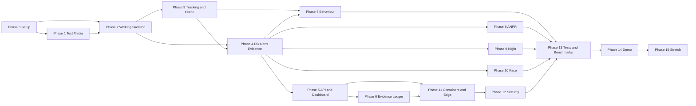

# FALCON Implementation Guide

This guide turns the FALCON PRD and TRD into ordered implementation steps. Read `docs/PRD.md` first for product decisions and `docs/TRD.md` for technical contracts. Follow only one step at a time.

## 1. Assumptions

| ID | Assumption |
|---|---|
| G-A01 | The team begins with Windows 11 and Docker Desktop; Linux commands are also supplied. |
| G-A02 | Python 3.12 is the baseline; exact third-party patch versions are pinned after compatibility resolution. |
| G-A03 | Node.js 20 LTS is the baseline for React and build tooling. |
| G-A04 | CPU-only development is supported for every P0 walkthrough. GPU and TensorRT/Jetson steps are optional. |
| G-A05 | MediaMTX is the local RTSP/HLS/WebRTC simulator for demo mode. |
| G-A06 | Redis Streams is the MVP local queue; MQTT remains the local/SOC integration option. |
| G-A07 | MinIO emulates S3 object storage during development. |
| G-A08 | FALCON demo watchlists contain synthetic or legally authorized test identities and plates only. |

## 2. Phase Index

| Phase | File | Primary outcome |
|---|---|---|
| 00 | `phase-00-setup.md` | Toolchain, repository, infrastructure, quality gates |
| 01 | `phase-01-test-media.md` | Legal test clips, RTSP simulator, phone camera, golden data |
| 02 | `phase-02-walking-skeleton.md` | Camera feed -> CPU detection -> console event |
| 03 | `phase-03-tracking-and-fence.md` | ByteTrack, foot-point, zone, intrusion event |
| 04 | `phase-04-database-alerts-evidence.md` | PostgreSQL, Redis/MQTT, alerts, snapshot/clip/MinIO |
| 05 | `phase-05-api-and-dashboard.md` | FastAPI and React MVP dashboard |
| 06 | `phase-06-evidence-ledger.md` | SHA-256 chain, Ed25519, Merkle batch, verification |
| 07 | `phase-07-behaviour-analytics.md` | Loitering, approach, speed, group, abandoned object |
| 08 | `phase-08-anpr.md` | Plate detection, OCR, Indian validation, watchlist |
| 09 | `phase-09-night-mode.md` | Night/IR switching and thermal model path |
| 10 | `phase-10-face-recognition.md` | RetinaFace, 512-D embeddings, FAISS, governed search |
| 11 | `phase-11-containers-and-edge.md` | Compose, systemd, sync, hardware exports |
| 12 | `phase-12-security-hardening.md` | mTLS, MFA, RBAC, secrets, SBOM, penetration checks |
| 13 | `phase-13-testing-and-benchmarks.md` | Test suites, coverage, metrics and benchmark report |
| 14 | `phase-14-demo-and-submission.md` | Demo script, fallback, PPT, pitch, repository |
| 15 | `phase-15-stretch-goals.md` | Re-ID, drone, pose, Fabric, multilingual/cloud |

## Web experience specifications

- [`../WEB_FLOW.md`](../WEB_FLOW.md) defines dashboard routes, actions, states, APIs, real-time behavior and QA traceability.
- [`../design/README.md`](../design/README.md) defines the visual identity, themes, components, accessibility and screen compositions.
- [`../BACKEND_SCHEMA.md`](../BACKEND_SCHEMA.md) describes the database schema and backend processing flow; [`../ERD.md`](../ERD.md) is the entity relationship diagram and [`../ASSUMPTIONS.md`](../ASSUMPTIONS.md) records schema decisions.
- [`../IMPLEMENTATION/01_IMPLEMENTATION_PLAN.md`](../IMPLEMENTATION/01_IMPLEMENTATION_PLAN.md) is the project-wide delivery plan; its [source inventory](../IMPLEMENTATION/00_SOURCE_INVENTORY.md), [conflict register](../IMPLEMENTATION/00_CONFLICTS_AND_DECISIONS.md), [task board](../IMPLEMENTATION/04_TASK_BOARD.csv), and [PPT coverage matrix](../IMPLEMENTATION/10_PPT_COVERAGE_MATRIX.md) define implementation and evidence gates.
- The frontend repository path is `apps/dashboard` per `docs/TRD.md`; the design token foundation is present there, but the React application still needs to be scaffolded.

## 3. Dependency Graph



**Critical path:** Phase 0 -> Phase 1 -> Phase 2 -> Phase 3 -> Phase 4 -> Phase 5 -> Phase 6 -> Phase 11 -> Phase 12 -> Phase 13 -> Phase 14.

P1 features run in parallel only after M0 and M1 are stable. Do not begin P1 implementation while M0 or M1 is failing.

## 4. Milestones

| Milestone | Demo-ready definition |
|---|---|
| M0 | One RTSP or MediaMTX stream produces person/vehicle detections and stage timing logs. |
| M1 | A video track crosses a drawn line or polygon and produces one intrusion event with explanation. |
| M2 | Camera -> detection -> fence -> database -> evidence -> FastAPI -> React dashboard works end-to-end. |
| M3 | An evidence file and manifest have a valid SHA-256 chain, Ed25519 signature, and verification result. |
| M4 | Offline interruption queues alert/evidence work, reconnect syncs once, and duplicate replay creates no duplicate event. |
| M5 | Rehearsed demo, measured benchmark report, clean repository, pitch and fallback media are ready. |

## 5. Cut-Line

Drop features in this order if time is short:

1. Cross-camera re-ID.
2. Drone/UAV head.
3. Climbing/crawling temporal action model.
4. Hyperledger Fabric anchoring.
5. Thermal fusion and cloud-edge hybrid extras.
6. Hindi UI, if English remains complete.
7. Face recognition P1, unless the team has validated private consent/exemption and safe watchlist workflow.
8. Night/thermal P1 only after the MVP virtual-fence demo is stable.
9. Do not cut camera ingestion, person/vehicle detection, tracking, virtual fence, alert, evidence, P0 ledger, or dashboard.

## 6. Week-by-Week Plan

| Week | CV/ML | Backend/DB | Frontend | DevOps/Security/Docs |
|---|---|---|---|---|
| 1 | Prepare clips and pretrained detector | Setup Docker/PostgreSQL/Redis/MinIO and base API | Dashboard shell and auth screen | Repository, CI, environments, MediaMTX |
| 2 | Detection, ByteTrack, benchmark skeleton | Event DB, alert state, MinIO evidence | Live wall and alert inbox | Compose, logging, unit tests, STRIDE |
| 3 | Virtual fence, behaviour prototypes | Ledger MVP, REST/WebSocket, sync queue | Zone editor, evidence viewer, map | Security controls, Docker hardening |
| 4 | ANPR/night/face only by gate | API finalization and offline tests | Full E2E workflow and polish | Benchmarks, demo, submission, rollback |

Parallel work is allowed after M0. Sync at the start of each day and at these points:

- Sync S1 after Phase 2: freeze message schemas and ports.
- Sync S2 after Phase 3: freeze track and zone IDs.
- Sync S3 after Phase 4: freeze event, alert, and evidence APIs.
- Sync S4 after Phase 5: freeze MVP demo flow.
- Sync S5 after Phase 13: freeze benchmark figures and pitch slides.

## 7. Team Roles

- **CV/ML owner:** capture, detection, tracking, benchmark and model phases.
- **Backend/DB owner:** FastAPI, PostgreSQL, Redis/MQTT, alert/evidence and sync.
- **Frontend/integration owner:** React, WebSocket, GIS, zone editor and E2E smoke test.
- **DevOps/security/docs owner:** Docker, systemd, CI, ledger, security, tests and submission.

Every role should review one other role’s pull request each day.

## 8. Daily Git Workflow

PowerShell:

```powershell
cd C:\Users\<user>\OneDrive\Pictures\OneDrive\Desktop\Falcon_Eye
git switch main
git pull --ff-only origin main
git switch -c feature/<issue>-<short-name>
git add <files>
git diff --cached
git commit -m "feat: implement <short change>"
git push -u origin feature/<issue>-<short-name>
```

Linux/bash:

```bash
cd /path/to/Falcon_Eye
git switch main
git pull --ff-only origin main
git switch -c feature/<issue>-<short-name>
git add <files>
git diff --cached
git commit -m "feat: implement <short change>"
git push -u origin feature/<issue>-<short-name>
```

For a conflict:

1. Run `git status`.
2. Open each conflict marker.
3. Keep the intended TRD/PRD contract.
4. Add the resolved files.
5. Run `git diff --check`.
6. Commit with `fix: resolve merge conflict in <area>`.

Never force-push `main` or `develop`.

## 9. Stuck Protocol

Paste this text into Copilot:

```text
I am on STEP <X.Y> of docs/guide.
OS: <Windows 11 / Ubuntu>.
Python: <version>.
I ran this command: <command>
I got this error (full text): <paste error>
Relevant files: <paths>
Read the step and docs/TRD.md.
Explain what is wrong in simple words.
Give the smallest fix and exact verification command.
Do not change unrelated files.
```

## 10. Step Status Table

| Step ID | PRD/TRD IDs | Owner | Estimate | Status |
|---|---|---|---:|---|
| STEP 0.1-0.12 | Setup, TR-ING-001, TR-SEC | DevOps/Security | 360 min | [ ] |
| STEP 1.1-1.10 | FR-001–008 | CV/ML | 300 min | [ ] |
| STEP 2.1-2.12 | FR-010–017, NFR-001 | CV/ML | 360 min | [ ] |
| STEP 3.1-3.12 | FR-040–046, TR-FENCE | CV/ML | 300 min | [ ] |
| STEP 4.1-4.14 | FR-070–085, DB-001–004 | Backend/DB | 420 min | [ ] |
| STEP 5.1-5.16 | API-001–030, UI-001–006 | Frontend/Backend | 480 min | [ ] |
| STEP 6.1-6.10 | SEC ledger, NFR-016 | Security | 300 min | [ ] |
| STEP 7.1-7.12 | FR-050–057 | CV/ML/Backend | 360 min | [ ] |
| STEP 8.1-8.14 | FR-030–035 | CV/ML/Backend | 420 min | [ ] |
| STEP 9.1-9.10 | FR-060–063 | CV/ML | 300 min | [ ] |
| STEP 10.1-10.12 | FR-020–026 | CV/ML/Security | 360 min | [ ] |
| STEP 11.1-11.14 | TR-SYNC-001, OPS | DevOps | 420 min | [ ] |
| STEP 12.1-12.12 | SEC-001–007 | DevOps/Security | 360 min | [ ] |
| STEP 13.1-13.14 | TST-001–010, NFR | QA/All | 420 min | [ ] |
| STEP 14.1-14.10 | Demo/Pitch | All | 300 min | [ ] |
| STEP 15.1-15.10 | FR-016, FR-056, FR-057 | CV/ML | 300 min | [ ] |

## 11. Guide Rules

Each step has one Goal, Implements list, Owner/Time, Prerequisites, Why, numbered micro-actions, exact files, Expected result, Verify command, failure fixes, Git commit, and Done when field.

GPU work is optional. A P0 CPU path must be complete before any GPU-specific optimization.

## 12. Source Conflict Register

The project-wide source inventory, precedence decisions and outstanding contract gaps are tracked in [`../IMPLEMENTATION/00_CONFLICTS_AND_DECISIONS.md`](../IMPLEMENTATION/00_CONFLICTS_AND_DECISIONS.md). Prior aligned choices remain: GStreamer/OpenCV capture with FFmpeg evidence encoding; ByteTrack default; PaddleOCR/EasyOCR choices subject to license/compatibility; 512-D face embeddings behind the privacy gate; local hash chain/Ed25519; and one active Redis/MQTT deployment pattern unless an approved requirement calls for both. The register also records unresolved API, prototype, hardware, evidence-window and performance-claim conflicts.
